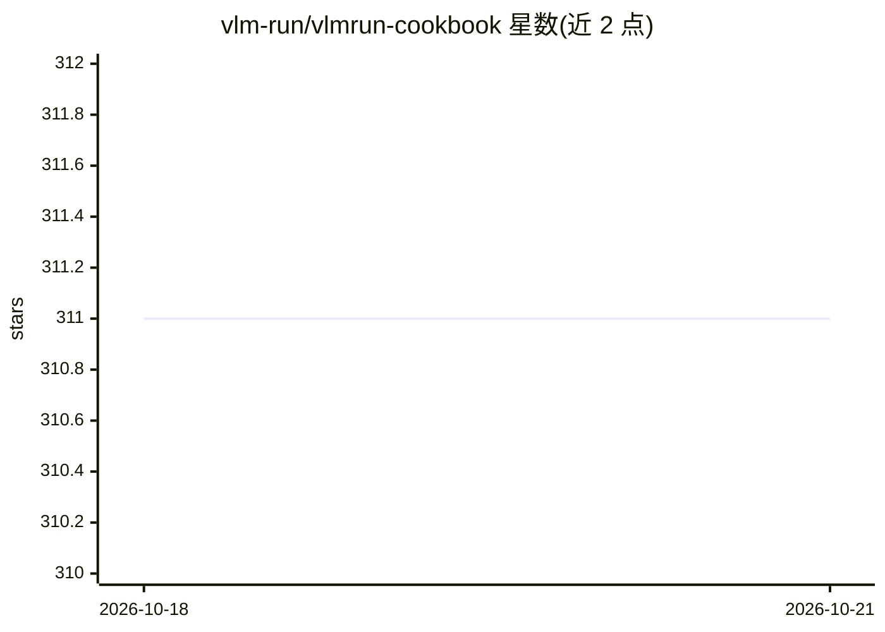

# vlm-run/vlmrun-cookbook

⭐ 311 · Jupyter Notebook · 推送 2026-10-20 · [GitHub](https://github.com/vlm-run/vlmrun-cookbook) · [官网](https://docs.vlm.run/introduction) · 组织维护

**VLM Run 平台的示例与教程集：图像/视频/文档结构化提取**

由 VLM Run 维护的 Colab Notebook 示例库，演示通过 VLM Run API 与 Orion 系列视觉语言模型，从图像、视频、文档中提取结构化数据。条目按类型分为 API 快速上手、功能示例（Schema、视觉定位、长视频转录、Markdown 提取）与应用案例（驾照识别、金融演示文稿解析、电视新闻分析、时尚目录、视频 RAG、医疗表单转 JSON 等），并含 Orion 2 迁移教程。面向已使用或评估 VLM Run 平台的开发者。

## 筛选速览

| 维度 | 判定 | 备注 |
|---|---|---|
| AI 角色 | `ai-knowledge` | 知识聚合/清单类 |
| 许可风险 | `none` | — |
| 部署形态 | `None` |  |
| 模型依赖 | — | README 未给出锁定关系 |
| 硬件要求 | — | 无带数字的原话,不猜 |
| 安装摩擦 | `low` | 无编译、无系统依赖或容器化 |
| 成熟度 | — | 结构信号不足 |

## 能力要点

- 20 个 Colab Notebook，覆盖图像/视频/文档结构化提取
- 按 feature/application/showcase 三类组织条目
- 包含 Orion 2 迁移与多 Schema 提取教程
- 示例覆盖金融、医疗、时尚、新闻等领域

## 适用场景

- 学习如何用 VLM Run API 做文档与图像结构化提取
- 为驾照识别、金融演示解析等场景找现成示例代码
- 从 Orion 旧版本迁移到 Orion 2

## 场景标签

 · 领域:计算机视觉/文档智能

## 证据(README 行号)

> L10: Welcome to **VLM Run Cookbook**, a comprehensive collection of examples and notebooks demonstrating the power of st
> L20: Our collection of Colab notebooks demonstrates various use cases and integrations:

## 星数曲线

2026-10-18 311 → 2026-10-21 311（+0）

---
*卡片 v1 · prompt 1.4 · 生成 2026-10-22 · 置信度 high · 依据 README sha `9ed56caf8e57` · [字段定义](../../DATASET.md)*
