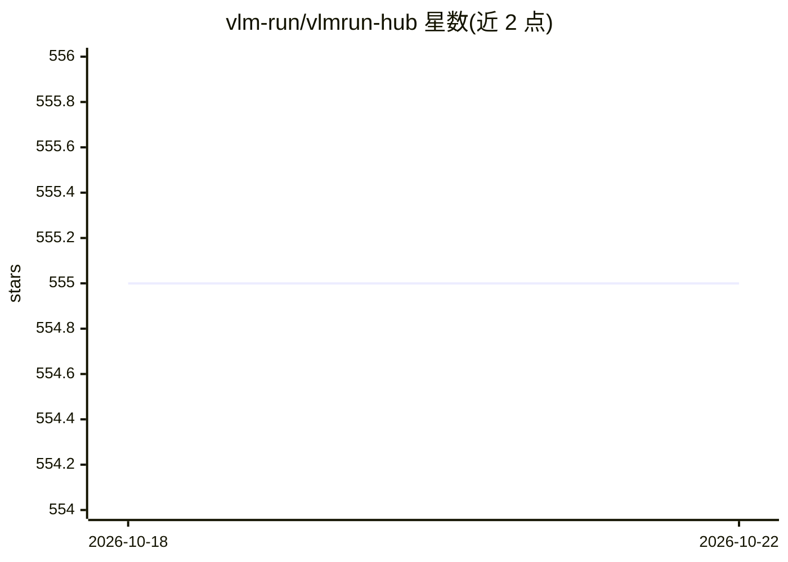

# vlm-run/vlmrun-hub

⭐ 555 · Python · Apache-2.0 · 推送 2025-12-15 · [GitHub](https://github.com/vlm-run/vlmrun-hub) · [官网](https://docs.vlm.run/hub) · 组织维护

**面向 VLM 的行业结构化抽取 Pydantic 模式库**

VLM Run Hub 收录预先定义的 Pydantic 数据模型（schema），用于从图像、视频、文档等非结构化视觉内容中抽取强类型、可验证的结构化数据。模式按行业分类：文档处理（发票、收据、驾照、护照等）、财务、医疗、零售、媒体等，均通过 Pydantic 内建校验。模式与具体 VLM 提供商无关，可配合 VLM Run SDK、Instructor/OpenAI、OpenAI Structured Outputs API 或本地 Ollama 使用，并附各模型在目录示例上的基准结果。以 pip 包形式分发。

## 筛选速览

| 维度 | 判定 | 备注 |
|---|---|---|
| AI 角色 | `ai-ecosystem` | LLM/agent 周边工具 |
| 许可风险 | `permissive` | Apache-2.0 |
| 部署形态 | `library` | 以包/库形式分发 |
| 模型依赖 | local-ok | 支持本地模型 |
| 硬件要求 | — | 无带数字的原话,不猜 |
| 安装摩擦 | `low` | 无编译、无系统依赖或容器化 |
| 成熟度 | — | 结构信号不足 |

## 能力要点

- 按行业组织的预定义 Pydantic 抽取模式目录（文档/财务/医疗/零售/媒体等）
- 模式与 VLM 提供商无关，可跨模型复用
- 内置 Pydantic 数据校验，兼容 mypy/pyright
- 目录附多个 VLM 模型的定性基准结果

## 适用场景

- 从发票、收据等文档图像抽取结构化字段
- 为 VLM 应用复用行业现成的输出 schema，跳过自行建模
- 对比不同 VLM 在同一 schema 集上的抽取效果

## 场景标签

 · 领域:计算机视觉/多模态数据抽取

## 证据(README 行号)

> L14: Welcome to **VLM Run Hub**, a comprehensive repository of pre-defined Pydantic schemas for extracting structured da
> L38: - 🧰 **Model-agnostic:** Use the same schema with multiple VLM providers, no need to rewrite prompts for different V

## 星数曲线

2026-10-18 555 → 2026-10-22 555（+0）

---
*卡片 v1 · prompt 1.4 · 生成 2026-10-21 · 置信度 high · 依据 README sha `e7bef5946dbc` · [字段定义](../../DATASET.md)*
