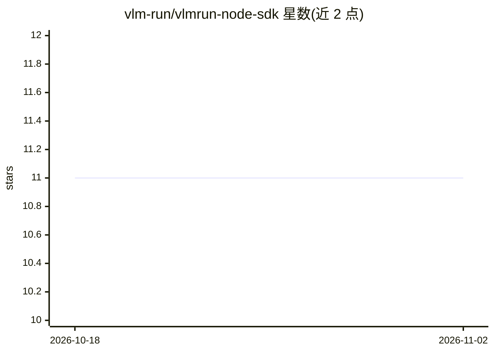

# vlm-run/vlmrun-node-sdk

⭐ 11 · TypeScript · Apache-2.0 · 推送 2026-10-31 · [GitHub](https://github.com/vlm-run/vlmrun-node-sdk) · [官网](https://docs.vlm.run/sdk-reference/node/getting-started) · 组织维护

**VLM Run 平台的官方 Node.js SDK，调用其视觉/文档 AI API**

VLM Run 官方 Node.js 客户端库，封装其 REST API：图像预测、文档预测、文件上传管理、模型列表、预测反馈，以及带 Zod 结构化输出的文档抽取。支持回调 URL 异步处理与 webhook 通知。提供 OpenAI 兼容的 chat completions（agent 端点，含流式输出，OpenAI SDK 为可选 peer 依赖），以及 System One 类型化问答（noul/choice/score 原语、forestry 问题集，支持 HTTP 与 WebSocket 传输）。使用需 VLM Run API key，Apache-2.0 许可。

## 筛选速览

| 维度 | 判定 | 备注 |
|---|---|---|
| AI 角色 | `ai-ecosystem` | LLM/agent 周边工具 |
| 许可风险 | `permissive` | Apache-2.0 |
| 部署形态 | `library` | 以包/库形式分发 |
| 模型依赖 | — | README 未给出锁定关系 |
| 硬件要求 | — | 无带数字的原话,不猜 |
| 安装摩擦 | `low` | 无编译、无系统依赖或容器化 |
| 成熟度 | — | 结构信号不足 |

## 能力要点

- 图像与文档预测，支持 Zod 结构化输出定义
- OpenAI 兼容 chat completions（agent 端点，含流式）
- 回调 URL 异步处理与 webhook 通知
- System One 类型化问答，支持 HTTP/WebSocket 流式

## 适用场景

- 在 Node.js 应用中接入 VLM Run 的视觉/文档 AI 接口
- 用熟悉的 OpenAI API 形式调用视觉语言模型
- 对图像、PDF 做结构化字段抽取

## 场景标签

`多模态` `文档解析` · 领域:知识与检索

## 证据(README 行号)

> L13: The VLM Run Node.js SDK is the official Node.js client for VLM Run API platform, providing a convenient way to inte
> L79: The VLM Run SDK provides OpenAI-compatible chat completions through the agent endpoint. This allows you to use the 

## 星数曲线

2026-10-18 11 → 2026-11-02 11（+0）

---
*卡片 v1 · prompt 1.4 · 生成 2026-11-01 · 置信度 high · 依据 README sha `591204bc0b19` · [字段定义](../../DATASET.md)*
