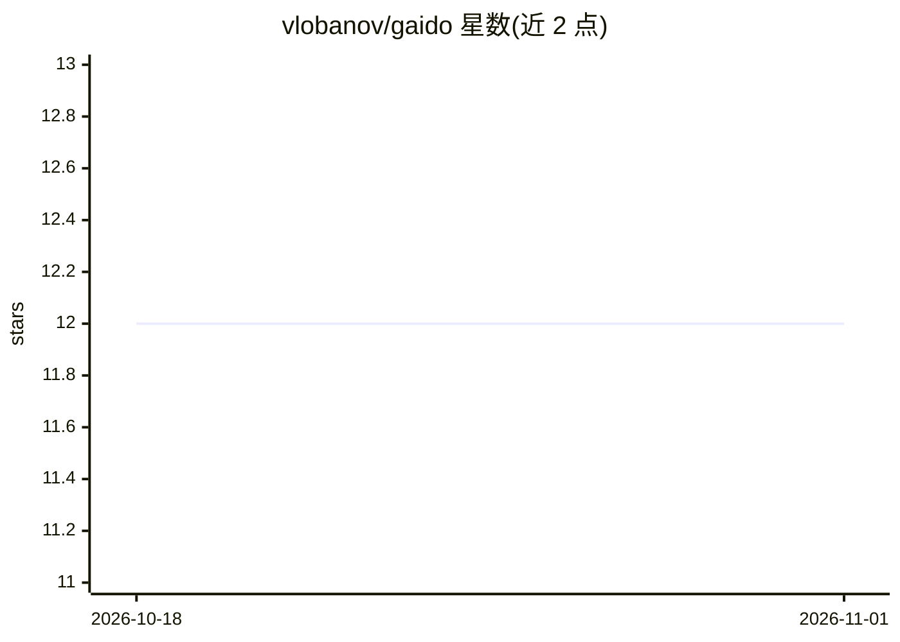

# vlobanov/gaido

⭐ 12 · TypeScript · MIT · 推送 2026-09-07 · [GitHub](https://github.com/vlobanov/gaido) · [官网](https://gaido.ai) · 个人维护

**创意编码 agent 的实验室笔记本：提示变节点图，可分叉迭代**

本地优先的创意编码实验工具：输入一段 brief，coder agent 在独立 git worktree 中生成网站、Pixi 场景或 canvas 实验，renderer 用无头 Chromium 按固定时钟渲染为可复现视频，critic agent（或人工）按 brief 评分并提出规则。每次尝试是图上的节点，分叉即 git 分支，失败分支保留。coder 以适配器形式接入 Claude Code、Codex、OpenCode、Cursor 等现有 CLI 订阅。声明早期阶段、单用户设计，需 Node 20+ 与 ffmpeg。

## 筛选速览

| 维度 | 判定 | 备注 |
|---|---|---|
| AI 角色 | `ai-native` | 本体是模型或模型工具 |
| 许可风险 | `permissive` | MIT |
| 部署形态 | `library` | 以包/库形式分发 |
| 模型依赖 | — | README 未给出锁定关系 |
| 硬件要求 | — | 无带数字的原话,不猜 |
| 安装摩擦 | `medium` | 含编译或系统依赖之一 |
| 成熟度 | `idea` | |

## 能力要点

- coder→渲染→critic 循环，每次尝试为节点，分叉即 git worktree 分支
- 无头 Chromium 固定时钟渲染，ffmpeg 编码，同代码同视频
- Coder 适配器可中途切换（Claude Code/Codex/OpenCode/Cursor）
- critic 反馈可晋升为 LESSONS.md 规则供后续会话继承

## 适用场景

- 把一个创意 brief 推过多轮 AI 生成与评审迭代
- 在可分叉的节点图上做 A/B 变体对比实验
- 让 critic 评审渲染结果并把经验沉淀为可复用规则

## 场景标签

`编码 Agent` · 领域:编码与开发

## 证据(README 行号)

> L3: **A lab notebook for creative-coding agents.** Type a brief; a coder agent
> L24: One instruction in, one rendered variation out. The coder works in its own
> L54: Coders are adapters — Claude Code, Codex, OpenCode, and Cursor ship in the

## 星数曲线

2026-10-18 12 → 2026-11-01 12（+0）

---
*卡片 v1 · prompt 1.4 · 生成 2026-10-31 · 置信度 high · 依据 README sha `37896a618344` · [字段定义](../../DATASET.md)*
