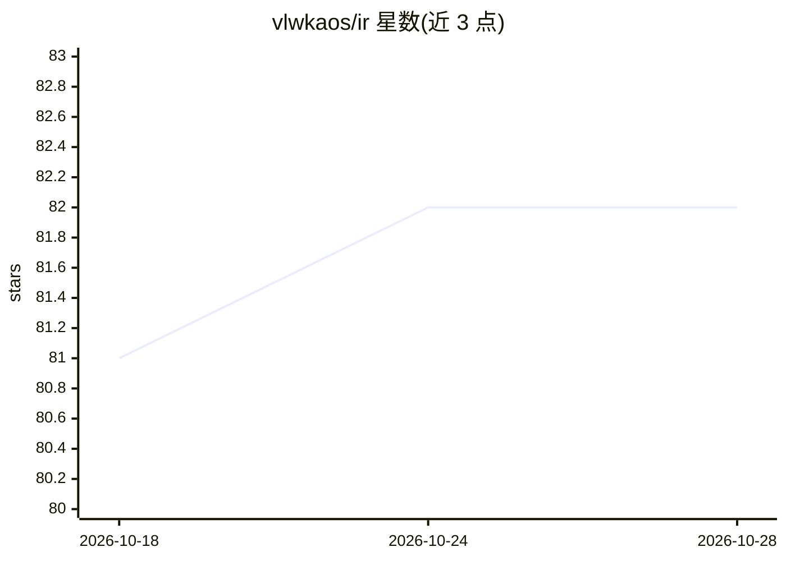

# vlwkaos/ir

⭐ 82 · Rust · MIT · 推送 2026-10-15 · [GitHub](https://github.com/vlwkaos/ir) · 个人维护 · 中文 README

**本地 Markdown 知识库语义搜索引擎，支持 CJK 分词**

用 Rust 编写的本地检索工具：对 Markdown 目录建立 BM25 + 向量 + 重排序三层检索管线，每个 collection 一个 SQLite 文件，常驻 daemon 保持模型常热并缓存全部输出，向量/重排模型首次使用时自动从 HuggingFace 下载。面向个人知识库用户，提供 CLI 与 MCP server（可接入 Claude Desktop/Code），内置 lindera 形态学分词器支持韩/日/中文 BM25。BM25 模式无需模型；LLM 查询扩展默认关闭。0.17 的图扩展与 HNSW 为实验特性标注。

## 筛选速览

| 维度 | 判定 | 备注 |
|---|---|---|
| AI 角色 | `ai-native` | 本体是模型或模型工具 |
| 许可风险 | `permissive` | MIT |
| 部署形态 | `library` | 以包/库形式分发 |
| 模型依赖 | local-ok | 支持本地模型 |
| 硬件要求 | — | 无带数字的原话,不猜 |
| 安装摩擦 | `medium` | 含编译或系统依赖之一 |
| 成熟度 | `idea` | |

## 能力要点

- 三层检索管线：BM25+文档图扩展、HNSW 向量+混合融合、0.6B 重排器
- 纯本地运行，单 SQLite 文件/collection，daemon 常热模型并缓存 LLM 输出
- CJK 形态学分词（lindera ko/ja/zh），无分词时韩文 BM25 接近 0
- 提供 MCP server（stdio 与 HTTP 模式）与可复现基准测试工具

## 适用场景

- 本地 Markdown 笔记库的混合语义检索
- 通过 MCP 让 Claude Desktop/Code 检索我的知识库
- 中韩日文知识库的 BM25/向量检索

## 场景标签

`语义搜索` · 领域:知识与检索

## 证据(README 行号)

> L10: Local semantic search for markdown knowledge bases. BM25 + vector + LLM reranking, entirely on your machine — one S
> L31:  ir 0.18 three-tier retrieval pipeline: Tier 0 BM25 + doc-graph expansion, Tier 1 HNSW ANN + hybrid fusion, Tier 2 
> L72: |Qwen3-Reranker 0.6B|reranking (optional)|

## 星数曲线

2026-10-18 81 → 2026-10-28 82（+1）

---
*卡片 v1 · prompt 1.4 · 生成 2026-10-24 · 置信度 high · 依据 README sha `e5ad5eea1213` · [字段定义](../../DATASET.md)*
