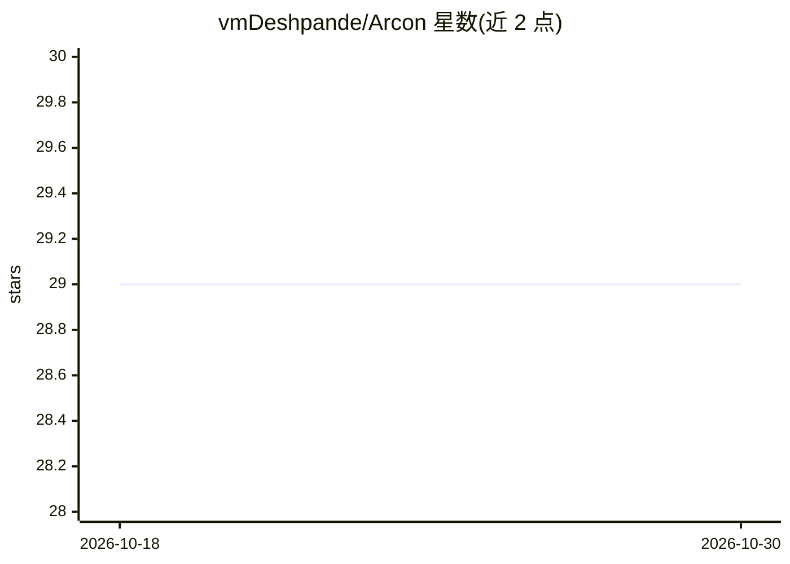

# vmDeshpande/Arcon

⭐ 29 · TypeScript · Apache-2.0 · 推送 2026-09-18 · [GitHub](https://github.com/vmDeshpande/Arcon) · 个人维护

**本地优先的认知架构：构建有记忆与个性的持久数字伴侣**

用 TypeScript/Node.js 与 Python 构建的认知架构，目标是搭建可长期记忆、学习并维持身份的数字伴侣。机制上把记忆、情感、个性、体验、推理拆为独立模块：SQLite 存储带生命周期状态的长期记忆（置信度/重要度评分、冲突检测、超集谱系），认知层在生成前做意图分类与澄清路由，配合 Qwen3-4B + 自训 LoRA 做本地推理。限制：积极开发中，预期破坏性变更；语义向量检索、语音、桌面应用仍在规划。

## 筛选速览

| 维度 | 判定 | 备注 |
|---|---|---|
| AI 角色 | `ai-ecosystem` | LLM/agent 周边工具 |
| 许可风险 | `permissive` | Apache-2.0 |
| 部署形态 | `None` |  |
| 模型依赖 | — | README 未给出锁定关系 |
| 硬件要求 | — | 无带数字的原话,不猜 |
| 安装摩擦 | `medium` | 含编译或系统依赖之一 |
| 成熟度 | `idea` | |

## 能力要点

- 记忆生命周期（6 状态）与置信度/重要度评分、超集谱系保留
- 认知核心：意图分类、策略决策、澄清路由，生成前处理
- 本地优先：SQLite 存储 + Qwen3-4B LoRA 推理，无需云端
- 反思引擎异步从体验中提议记忆变更，全程可审计

## 适用场景

- 搭建不遗忘、可积累关系的长期个人 AI 伴侣
- 研究模块化认知架构（记忆/情感/个性分离）的实现
- 在本地硬件上运行带持久记忆的对话系统

## 场景标签

`AI 助手` `Agent 记忆` `Agent 框架` · 领域:Agent 开发

## 证据(README 行号)

> L3: > **A local-first cognitive architecture for building a persistent digital companion.**
> L39: **Arcon is an experiment in building those systems as independent architectural components instead of hiding everyt
> L122: The runtime never returns raw context as a response. The model remains responsible for natural-language understand
> L313: |**memory**|SQLite repositories, memory pipeline, retrieval, reflection, entity graph|

## 星数曲线

2026-10-18 29 → 2026-10-30 29（+0）

---
*卡片 v1 · prompt 1.4 · 生成 2026-10-26 · 置信度 high · 依据 README sha `bb67773ad04b` · [字段定义](../../DATASET.md)*
