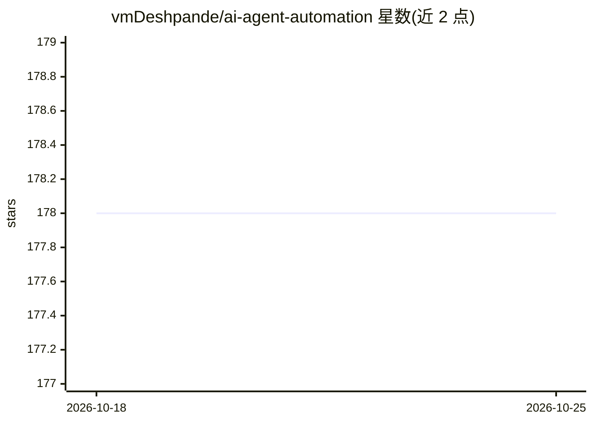

# vmDeshpande/ai-agent-automation

⭐ 178 · TypeScript · Apache-2.0 · 推送 2026-09-12 · [GitHub](https://github.com/vmDeshpande/ai-agent-automation) · 个人维护

**自托管 AI agent 工作流自动化平台：构建、运行与审计**

本地优先（local-first）的自托管工作流引擎，用于构建与运行 AI 驱动的自动化流程。提供可视化工作流构建器（LLM、HTTP、邮件、浏览器、审批、并行等多种节点）、agent 配置与多 agent 团队、文档 RAG 与语义记忆、MCP 与 A2A 集成、定时调度器，以及任务级执行可观测性（步骤输入输出、日志、回放）。面向希望运行可检查自动化而非黑盒聊天机器人的开发者。通过 Docker Compose 一键部署（含 MongoDB 副本集、后端、Worker、前端），或本地以 npm 分服务运行；需配置至少一个 LLM provider API key 或本地 Ollama 实例。

## 筛选速览

| 维度 | 判定 | 备注 |
|---|---|---|
| AI 角色 | `ai-ecosystem` | LLM/agent 周边工具 |
| 许可风险 | `permissive` | Apache-2.0 |
| 部署形态 | `self-host` | docker 或自建部署 |
| 模型依赖 | local-ok | 支持本地模型 |
| 硬件要求 | — | 无带数字的原话,不猜 |
| 安装摩擦 | `low` | 无编译、无系统依赖或容器化 |
| 成熟度 | — | 结构信号不足 |

## 能力要点

- 可视化工作流构建器，含 LLM/HTTP/浏览器/审批/并行/agent 调用等节点
- 任务级可观测性：步骤输入输出、日志、状态与回放控制
- 文档 RAG、语义记忆、多 agent 团队与 A2A webhook 支持
- 工作流可暴露为带 API-key 认证的公开端点

## 适用场景

- 在自己基础设施上构建并运行 AI 自动化工作流
- 对工作流执行过程逐步检查、排错与回放
- 上传文档并基于来源引用进行对话问答
- 通过 cron 调度与 Webhook API 触发自动化任务

## 场景标签

`工作流自动化` `多智能体` `文档问答` · 领域:Agent 开发

## 证据(README 行号)

> L38: AI Agent Automation is a self-hosted workflow engine for building and operating AI-driven automations. It combines 
> L40: It is built for developers who want inspectable automation instead of a black-box chatbot or hosted SaaS dependency

## 星数曲线

2026-10-18 178 → 2026-10-25 178（+0）

---
*卡片 v1 · prompt 1.4 · 生成 2026-10-22 · 置信度 high · 依据 README sha `3162c6025ffd` · [字段定义](../../DATASET.md)*
