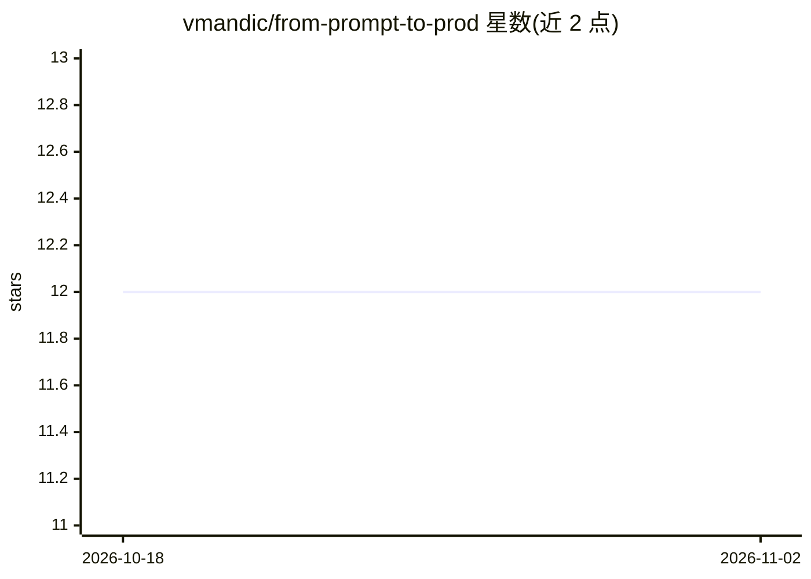

# vmandic/from-prompt-to-prod

⭐ 12 · Python · MIT · 推送 2026-09-08 · [GitHub](https://github.com/vmandic/from-prompt-to-prod) · [官网](https://vmandic.github.io/from-prompt-to-prod/) · 个人维护

**AI 编辑器 agentic 开发实践演讲资料与自审提示词**

存放 Vedran Mandić 在 CroAI 分享的演讲幻灯片（PDF 与 Keynote 源文件），主题为 Cursor 与 agent 式开发：从对话中的想法到可交付成果的流程，覆盖上下文管理、项目配置（AGENTS.md、规则、技能、MCP）、agentic 循环（计划-生成-审查-验证）、提示技巧与安全实践。另附一个自审 rubric 提示词文件，可交给任意编码 agent 对用户项目做工作流审计。仓库本身为演讲材料，非可安装产品。

## 筛选速览

| 维度 | 判定 | 备注 |
|---|---|---|
| AI 角色 | `ai-knowledge` | 知识聚合/清单类 |
| 许可风险 | `permissive` | MIT |
| 部署形态 | `None` |  |
| 模型依赖 | — | README 未给出锁定关系 |
| 硬件要求 | — | 无带数字的原话,不猜 |
| 安装摩擦 | `low` | 无编译、无系统依赖或容器化 |
| 成熟度 | — | 结构信号不足 |

## 能力要点

- 提供 PDF 与 Keynote 两种格式幻灯片
- 自审 rubric 提示词可由任意编码 agent 执行项目级/机器级审计
- 附静态提示词模板（computer-wide / project-only）
- 整理演讲引用的社区资源（技能库、记忆工具、团队技能分发）

## 适用场景

- 阅读 Cursor 与 agent 式开发的实践要点
- 用自审提示词检查自己的 agentic 工作流配置
- 查找 agent 技能相关的社区工具与资源

## 场景标签

`提示工程` `教程课程` · 领域:Agent 开发

## 证据(README 行号)

> L10: This repo holds the **slides** so you can read them at your own pace:
> L37: This is how you can **see whether your project and workflow line up** with the practices from the presentation Vedr

## 星数曲线

2026-10-18 12 → 2026-11-02 12（+0）

---
*卡片 v1 · prompt 1.4 · 生成 2026-11-01 · 置信度 high · 依据 README sha `77724ff7458c` · [字段定义](../../DATASET.md)*
