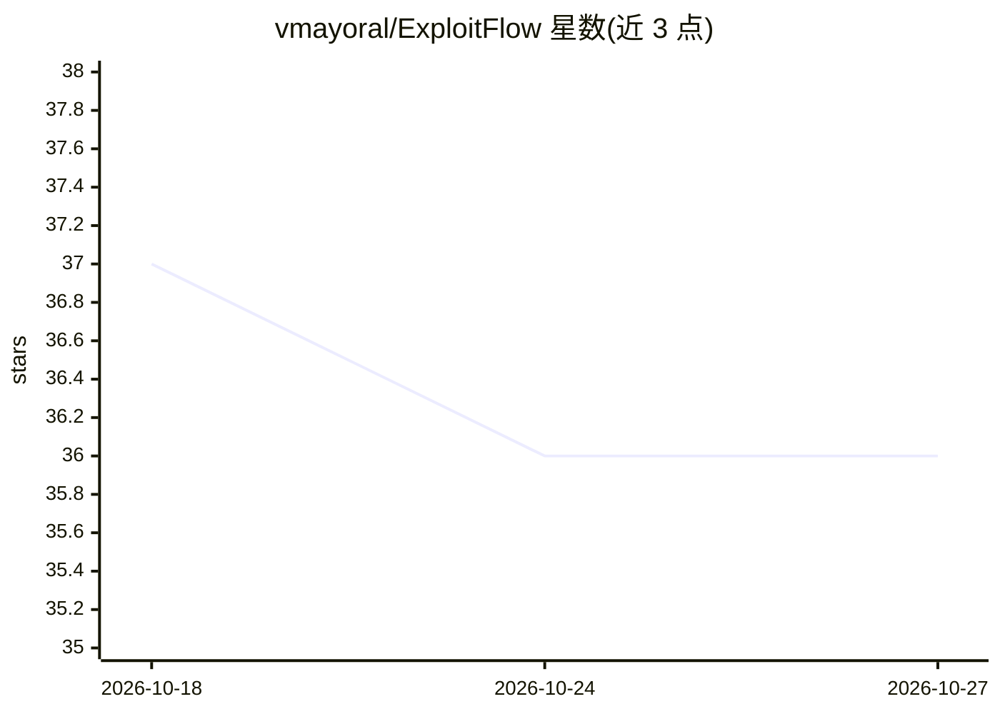

# vmayoral/ExploitFlow

⭐ 36 · Python · Apache-2.0 · 推送 2026-07-14 · [GitHub](https://github.com/vmayoral/ExploitFlow) · [官网](https://cybersecurityrobotics.com/research/offensive-robot-cybersecurity/) · 个人维护

**组合安全利用动作生成利用链的 Python 库，服务 AI 安全研究**

模块化 Python 库，用于构建网络安全利用路径（exploit flows）：把侦察、漏洞利用、提权、横向移动、数据外泄、命令控制六类动作表示为 Exploit 超类并在 Flow 中组合，逐步捕获被测系统状态。语法与架构参考 TensorFlow，定位是支撑博弈论与 AI 在网络安全方向的研究，明确声明自身不是利用框架；通过适配器（如 Metasploit）接入其他框架的利用代码。提供 Docker 开发容器方式，含法律使用限制声明。

## 筛选速览

| 维度 | 判定 | 备注 |
|---|---|---|
| AI 角色 | `ai-ecosystem` | LLM/agent 周边工具 |
| 许可风险 | `permissive` | Apache-2.0 |
| 部署形态 | `None` |  |
| 模型依赖 | — | README 未给出锁定关系 |
| 硬件要求 | — | 无带数字的原话,不猜 |
| 安装摩擦 | `low` | 无编译、无系统依赖或容器化 |
| 成熟度 | — | 结构信号不足 |

## 能力要点

- 六类 kill chain 动作统一为 Exploit 超类并可组合成 Flow
- 通过 Adapter（如 AdapterMSF/Metasploit）接入外部利用框架
- 每步离散动作后捕获被测系统状态
- 语法与架构参考 TensorFlow 以降低研究采纳成本

## 适用场景

- 为博弈论/AI 网络安全研究构建可组合的利用动作序列
- 把多个利用框架的 exploit 统一表示后做自动化规划实验
- 在攻防实验中跟踪系统状态随动作的变化

## 场景标签

`网络安全` · 领域:学习与行业

## 证据(README 行号)

> L3: ExploitFlow (`EF`) is a modular library to produce cybersecurity exploitation routes (*exploit flows*). It aims to c
> L5: It's main motivation is to facilitate and empower Game Theory and Artificial Intelligence (AI) research in cybersecu
> L14: `EF` is a modular, extensible (accepting connectors for other exploitation frameworks and/or individual exploits) a

## 星数曲线

2026-10-18 37 → 2026-10-27 36（-1）

---
*卡片 v1 · prompt 1.4 · 生成 2026-10-25 · 置信度 high · 依据 README sha `73c134d841d0` · [字段定义](../../DATASET.md)*
