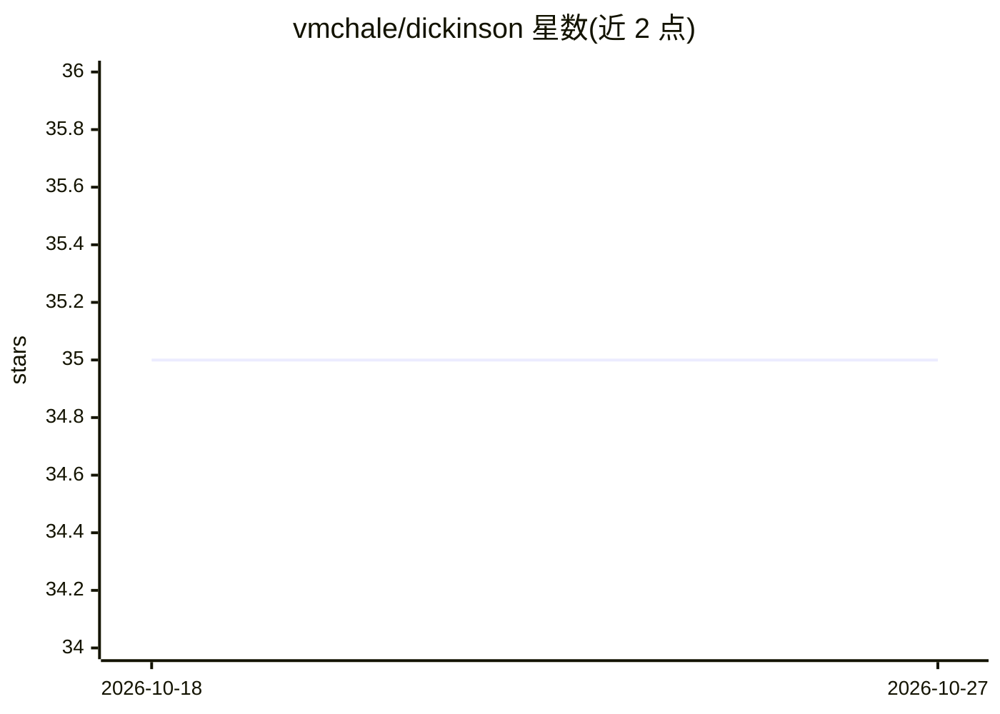

# vmchale/dickinson

⭐ 35 · Haskell · BSD-3-Clause · 推送 2026-04-07 · [GitHub](https://github.com/vmchale/dickinson) · 个人维护

**文本生成 DSL：供写生成式文学/随机文本的程序**

Dickinson 是一门用于文本生成的领域专用语言，提供 REPL 与命令行工具 emd，用户编写 .dck 程序生成文本（README 附 fortune 式示例）。以 Haskell（cabal/GHC）实现，提供部分平台的二进制发行包（make install）、安装脚本、cabal 源码安装与网页试运行四种途径，另附 vim 编辑器集成、markdown/PDF 用户指南与 man 手册。无 AI 模型相关内容。

## 筛选速览

| 维度 | 判定 | 备注 |
|---|---|---|
| AI 角色 | `ai-native` | 本体是模型或模型工具 |
| 许可风险 | `permissive` | BSD-3-Clause |
| 部署形态 | `None` |  |
| 模型依赖 | — | README 未给出锁定关系 |
| 硬件要求 | — | 无带数字的原话,不猜 |
| 安装摩擦 | `medium` | 含编译或系统依赖之一 |
| 成熟度 | — | 结构信号不足 |

## 能力要点

- 文本生成领域专用语言，附 REPL 与 emd 命令行工具
- 四种安装途径：网页试运行、二进制包、安装脚本、cabal 源码安装
- 提供 vim 编辑器集成与 markdown/PDF 用户指南

## 适用场景

- 编写生成随机或组合文本的程序（如 fortune 式语句）
- 在 REPL 中交互式构造文本生成逻辑

## 场景标签

 · 领域:编程语言/文本生成

## 证据(README 行号)

> L3: Dickinson is a text-generation language.
> L69: A riff on the Unix fortune program is available

## 星数曲线

2026-10-18 35 → 2026-10-27 35（+0）

---
*卡片 v1 · prompt 1.4 · 生成 2026-10-25 · 置信度 mid · 依据 README sha `1885a7633a3b` · [字段定义](../../DATASET.md)*
