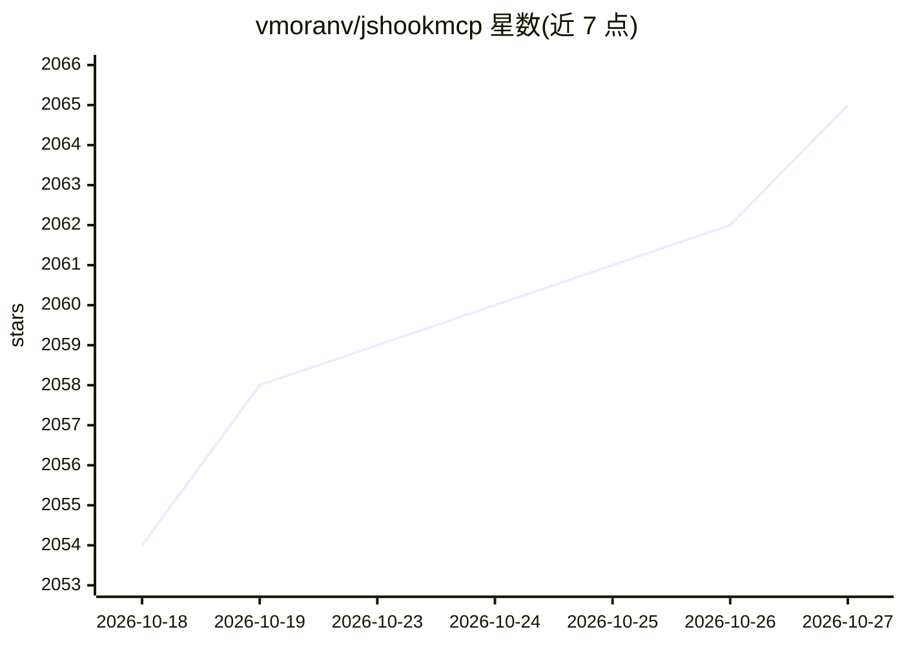

# vmoranv/jshookmcp

⭐ 2,065 · TypeScript · AGPL-3.0 · 推送 2026-10-25 · [GitHub](https://github.com/vmoranv/jshookmcp) · [官网](https://vmoranv.github.io/jshookmcp/) · 个人维护 · 中文 README

**面向 AI agent 的 JS 逆向工程 MCP 服务器（735 工具/36 域）**

以 MCP 服务器形式向 AI agent 提供前端与二进制逆向工程工具集：内置 735 个工具、36 个自动发现的域，覆盖浏览器自动化（Chromium/Camoufox/CDP、反检测）、网络拦截（MITM CA、HTTP/2 帧、WebSocket 捕获、Burp 桥）、JS 反混淆与 AST 分析、WASM 反汇编（wabt/Binaryen）、Frida/Ghidra/IDA 桥、进程内存取证与 APK 分析。核心机制是 search-first 的分级 profile（search 约 3K tokens / workflow / full 约 109K tokens）以控制 token 成本，支持 stdio 与 Streamable HTTP 两种传输及会话恢复。需 Node.js 22.22.2+，通过 MCP 客户端配置或 npm 安装。

## 筛选速览

| 维度 | 判定 | 备注 |
|---|---|---|
| AI 角色 | `ai-ecosystem` | LLM/agent 周边工具 |
| 许可风险 | `viral` | AGPL-3.0 |
| 部署形态 | `library` | 以包/库形式分发 |
| 模型依赖 | — | README 未给出锁定关系 |
| 硬件要求 | — | 无带数字的原话,不猜 |
| 安装摩擦 | `low` | 无编译、无系统依赖或容器化 |
| 成熟度 | — | 结构信号不足 |

## 能力要点

- 735 个内置工具、36 个自动发现的域，单一 MCP 工具面
- search/workflow/full 三级 profile 控制 token 成本（3K→109K）
- 浏览器自动化（CDP/反检测/显式输入 CAPTCHA）、MITM 网络拦截、WASM 反汇编、Frida/Ghidra/IDA 桥
- 热重载插件、YAML 声明式工作流、Streamable HTTP 会话状态恢复

## 适用场景

- 让 agent 反混淆压缩后的 JS bundle 并理解代码逻辑
- 抓取并重放 OAuth 流程等网络请求
- 对可疑 APK 做静态分诊与反编译
- 多个 agent 共享一个本地逆向工作守护进程

## 场景标签

`浏览器自动化` `网络安全` · 领域:效率与自动化

## 证据(README 行号)

> L11: **A search-first, profile-aware reverse-engineering workspace for AI agents.**
> L66: - **Search-first, profile-aware.** The `search` profile loads about 3K tokens of tool metadata; the `full` profile 
> L78: |**Tool profiles**|`search` (~3K tokens, BM25 + hybrid vector ranking) · `workflow` (composite scripts) · `full` (a

## 星数曲线

2026-10-18 2,054 → 2026-10-27 2,065（+11）

---
*卡片 v1 · prompt 1.4 · 生成 2026-10-21 · 置信度 high · 依据 README sha `cd298a7484c0` · [字段定义](../../DATASET.md)*
