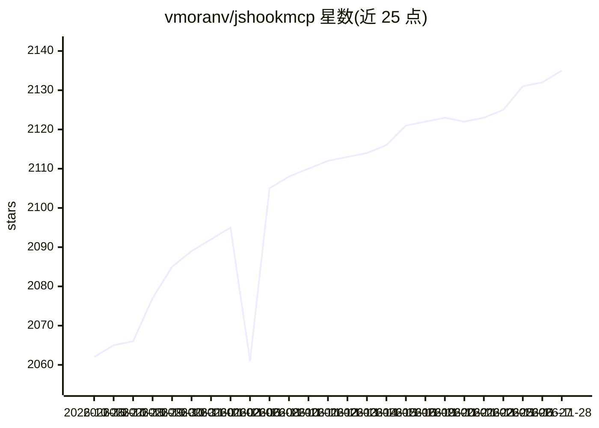

# vmoranv/jshookmcp

⭐ 2,135 · TypeScript · AGPL-3.0 · 推送 2026-11-26 · [GitHub](https://github.com/vmoranv/jshookmcp) · [官网](https://vmoranv.github.io/jshookmcp/) · 个人维护 · 中文 README

**面向 AI agent 的 JS 逆向工程 MCP 服务器，含 735+ 工具**

以 MCP 服务器形式提供的前端逆向工程工作区：工具按 36 个领域组织，通过 search/workflow/full 三档 profile 控制暴露给模型的 schema 体积（search 档约 3K tokens）。能力覆盖 Chromium/Camoufox 浏览器自动化、网络拦截与 MITM、反混淆、WASM 反汇编（wabt）、Frida/Ghidra/IDA 桥接、APK 分析、进程内存取证等。支持 stdio 与 Streamable HTTP 两种传输，多 agent 可共享一个本地 daemon。默认开启 opt-out 遥测，可用环境变量关闭。

## 筛选速览

| 维度 | 判定 | 备注 |
|---|---|---|
| AI 角色 | `ai-ecosystem` | LLM/agent 周边工具 |
| 许可风险 | `viral` | AGPL-3.0 |
| 部署形态 | `library` | 以包/库形式分发 |
| 模型依赖 | — | README 未给出锁定关系 |
| 硬件要求 | — | 无带数字的原话,不猜 |
| 安装摩擦 | `low` | 无编译、无系统依赖或容器化 |
| 成熟度 | — | 结构信号不足 |

## 能力要点

- search-first 三档工具 profile 控制上下文 token 成本
- 浏览器自动化与反检测预设、显式输入 CAPTCHA 求解
- wabt WASM 反汇编与 Frida/Ghidra/IDA 桥接
- Streamable HTTP 会话恢复与多客户端状态隔离

## 适用场景

- 让 AI agent 分析混淆的前端 JS 代码并还原逻辑
- 通过 MCP 客户端驱动浏览器抓包并重放请求
- 对可疑 APK 做静态分析
- 在本地多个 agent 间共享浏览器运行时与缓存

## 场景标签

`浏览器自动化` · 领域:效率与自动化

## 证据(README 行号)

> L13: **A search-first, profile-aware reverse-engineering workspace for AI agents.**
> L58: Most MCP servers for JS analysis expose a handful of hand-rolled tools or wrap a single browser engine. jshook is c
> L102: No global install needed — add to your MCP client config and you're ready.

## 星数曲线

2026-10-26 2,062 → 2026-11-28 2,135（+73）

---
*卡片 v1 · prompt 1.4 · 生成 2026-11-26 · 置信度 high · 依据 README sha `a0ca734caa2c` · [字段定义](../../DATASET.md)*
