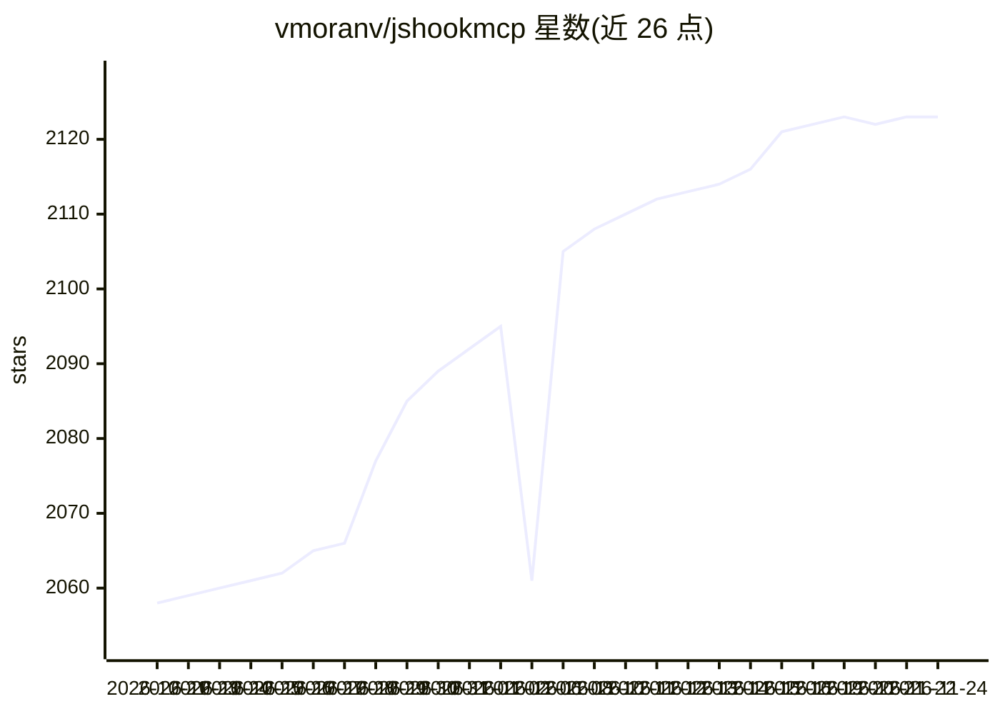

# vmoranv/jshookmcp

⭐ 2,125 · TypeScript · AGPL-3.0 · 推送 2026-11-23 · [GitHub](https://github.com/vmoranv/jshookmcp) · [官网](https://vmoranv.github.io/jshookmcp/) · 个人维护 · 中文 README

**给 AI agent 的 JS 逆向工程 MCP 服务器，36 域 700+ 工具**

一个 MCP 服务器，为 AI agent 提供前端与二进制逆向工程工具集：浏览器自动化（Chromium/Camoufox via CDP、反检测、显式输入验证码求解）、网络拦截（MITM 代理、HTTP/2、WebSocket、Burp 桥）、JS 反混淆与 AST 变换、WASM 反汇编、进程/内存取证、Frida/Ghidra/IDA 桥、APK 分析等 36 个域。通过 search/workflow/full 三档工具 profile 控制 token 开销，支持 stdio 与 Streamable HTTP 传输、会话恢复与热加载插件。需 Node.js 22.22.2+，AGPLv3 许可，默认开启可关闭的遥测。

## 筛选速览

| 维度 | 判定 | 备注 |
|---|---|---|
| AI 角色 | `ai-ecosystem` | LLM/agent 周边工具 |
| 许可风险 | `viral` | AGPL-3.0 |
| 部署形态 | `library` | 以包/库形式分发 |
| 模型依赖 | — | README 未给出锁定关系 |
| 硬件要求 | — | 无带数字的原话,不猜 |
| 安装摩擦 | `low` | 无编译、无系统依赖或容器化 |
| 成熟度 | — | 结构信号不足 |

## 能力要点

- search-first profile 阶梯：search 约 3K token 元数据，full 暴露全部 739 工具
- 浏览器自动化与反检测预设、显式输入验证码求解
- WASM 反汇编（wabt/Binaryen）、Frida/Ghidra/IDA 桥、硬件断点
- Streamable HTTP 会话恢复与多 agent 状态隔离

## 适用场景

- 让 AI agent 去混淆并理解压缩的前端代码
- 抓取、拦截并重放 OAuth/GraphQL 请求流
- 逆向 WASM 加密例程或对活进程做内存取证
- 对可疑 APK 做静态分诊与反编译

## 场景标签

`浏览器自动化` `网络安全` · 领域:效率与自动化

## 证据(README 行号)

> L13: **A search-first, profile-aware reverse-engineering workspace for AI agents.**
> L15: **Hook the page, capture the network, deobfuscate the bundle, disassemble the WASM, instrument the process — and le
> L60: - **Search-first, profile-aware.** The `search` profile loads about 3K tokens of tool metadata; the `full` profile 

## 星数曲线

2026-10-21 2,058 → 2026-11-24 2,123（+65）

---
*卡片 v1 · prompt 1.4 · 生成 2026-11-24 · 置信度 high · 依据 README sha `f13e01ee0846` · [字段定义](../../DATASET.md)*
