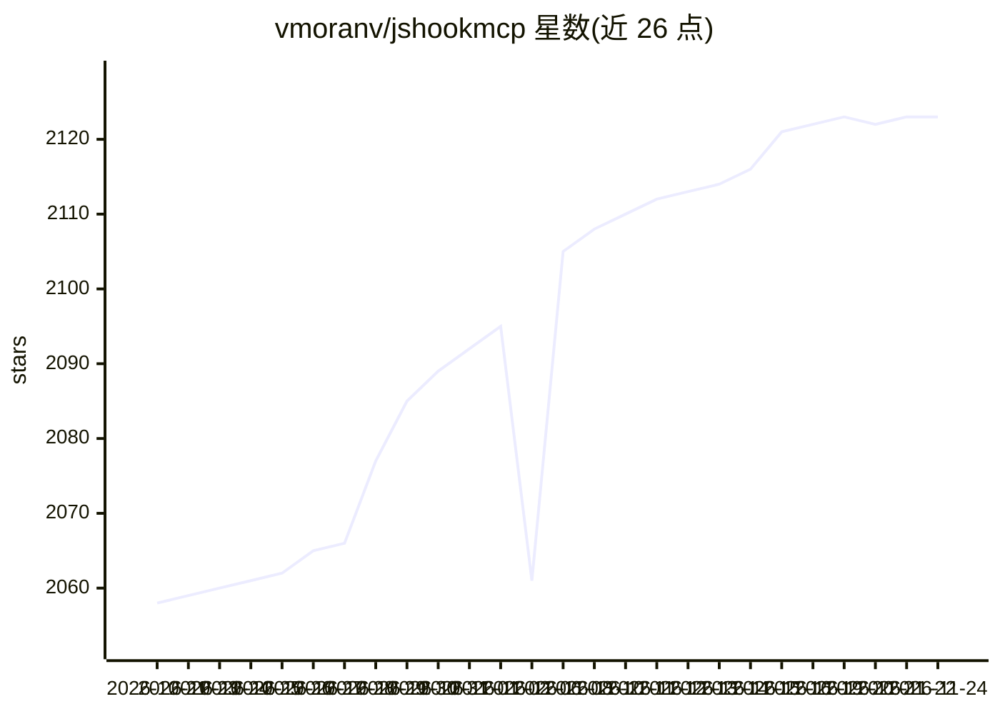

# vmoranv/jshookmcp

⭐ 2,123 · TypeScript · AGPL-3.0 · 推送 2026-11-22 · [GitHub](https://github.com/vmoranv/jshookmcp) · [官网](https://vmoranv.github.io/jshookmcp/) · 个人维护 · 中文 README

**面向 AI agent 的 JS 逆向工程 MCP 服务器，735+ 工具覆盖 36 领域**

基于 MCP 协议的前端逆向工程工具服务器：通过 stdio 或 Streamable HTTP 向 AI agent 提供 36 个领域、700+ 工具，覆盖浏览器自动化（CDP、反检测、CAPTCHA 显式输入求解）、网络拦截（MITM 代理、HTTP/2、GraphQL/Burp 桥）、WASM 反汇编、Frida/Ghidra/IDA 桥接、APK 分析等。采用 search/workflow/full 三档工具画像控制 token 开销，支持会话恢复、多 agent 状态隔离与热加载插件。Node.js 22.22.2+ 运行，AGPLv3 许可，默认开启可关闭的遥测。

## 筛选速览

| 维度 | 判定 | 备注 |
|---|---|---|
| AI 角色 | `ai-ecosystem` | LLM/agent 周边工具 |
| 许可风险 | `viral` | AGPL-3.0 |
| 部署形态 | `library` | 以包/库形式分发 |
| 模型依赖 | — | README 未给出锁定关系 |
| 硬件要求 | — | 无带数字的原话,不猜 |
| 安装摩擦 | `low` | 无编译、无系统依赖或容器化 |
| 成熟度 | — | 结构信号不足 |

## 能力要点

- search/workflow/full 三档工具画像：约 3K token 元数据到全量 739 工具
- Chromium/Camoufox 浏览器自动化，含反检测预设与显式输入 CAPTCHA 求解
- wabt WASM 反汇编、Frida/Ghidra/IDA 桥接、硬件断点、PE 检查
- Streamable HTTP 会话恢复与多 agent 浏览器状态隔离

## 适用场景

- 让 AI agent 反混淆压缩的 JS bundle 并理解代码
- 抓取并重放 OAuth 或 GraphQL 请求流程
- 逆向 WASM 加密例程并生成钩子
- 对可疑 APK 做静态分诊与反编译分析

## 场景标签

`浏览器自动化` `网络安全` · 领域:效率与自动化

## 证据(README 行号)

> L13: **A search-first, profile-aware reverse-engineering workspace for AI agents.**
> L58: Most MCP servers for JS analysis expose a handful of hand-rolled tools or wrap a single browser engine. jshook is c
> L118: **This is a Node.js service, not a browser library.** It runs over stdio or a local

## 星数曲线

2026-10-21 2,058 → 2026-11-24 2,123（+65）

---
*卡片 v1 · prompt 1.4 · 生成 2026-11-23 · 置信度 high · 依据 README sha `b08b0cd3f0a7` · [字段定义](../../DATASET.md)*
