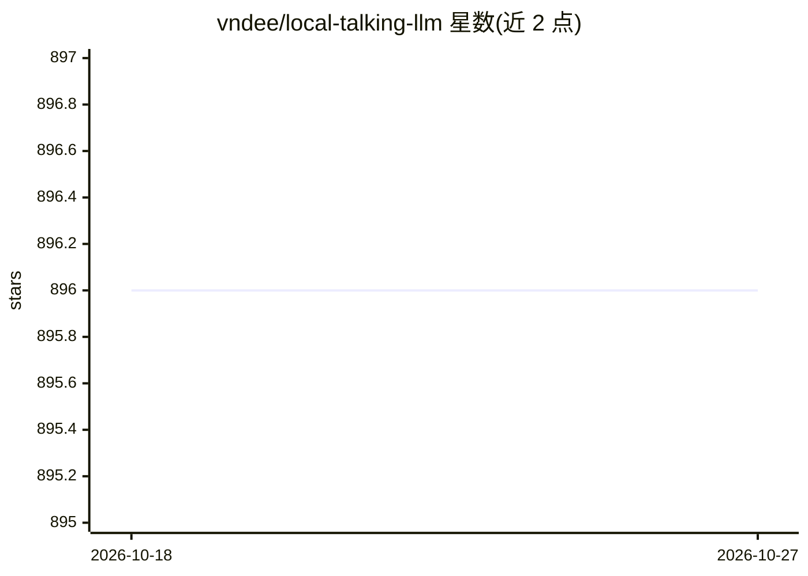

# vndee/local-talking-llm

⭐ 896 · Python · MIT · 推送 2026-04-04 · [GitHub](https://github.com/vndee/local-talking-llm) · [官网](https://blog.duy.dev/build-your-own-voice-assistant-and-run-it-locally/) · 个人维护

**本地离线语音助手：Whisper 语音识别+Ollama 对话+Chatterbox 合成**

在本地计算机上运行的语音助手应用，可在无网络环境下工作：用 Whisper 将语音转录为文本，经 Langchain 接入可插拔 LLM 后端（默认本地 Ollama，如 Gemma3，也可换用 MiniMax 云端），再用 Chatterbox TTS 将回复合成为语音。支持基于 10-30 秒音频样本的声音克隆、情感强度与语速参数调节、自动情感分析与生成音频保存。以 Python 源码仓库形式提供，推荐用 uv 管理依赖，运行 python app.py 启动；使用云端后端时不需本地 GPU。

## 筛选速览

| 维度 | 判定 | 备注 |
|---|---|---|
| AI 角色 | `ai-native` | 本体是模型或模型工具 |
| 许可风险 | `permissive` | MIT |
| 部署形态 | `library` | 以包/库形式分发 |
| 模型依赖 | local-ok | 支持本地模型 |
| 硬件要求 | — | 无带数字的原话,不猜 |
| 安装摩擦 | `medium` | 含编译或系统依赖之一 |
| 成熟度 | — | 结构信号不足 |

## 能力要点

- Whisper 语音识别 + LLM 对话 + Chatterbox 语音合成的全离线路径
- 用短音频样本克隆声音，可调节情感强度与语速
- LLM 后端可插拔：本地 Ollama 或云端 MiniMax
- 自动情感分析按文本内容调整语音表现力

## 适用场景

- 在自己电脑上搭建可离线运行的对话语音助手
- 克隆特定声音让助手以该声音回应
- 无本地 GPU 时切换 MiniMax 云端模型获得对话能力

## 场景标签

`语音 Agent` `语音合成` · 领域:对话与助手

## 证据(README 行号)

> L1: ## Build your own voice assistant and run it locally: Whisper + Ollama + ChatterBox
> L31: The most critical component here is the Large Language Model (LLM) backend. By default, we use **Ollama** for runni
> L40: The workflow is straightforward: record speech, transcribe to text, generate a response using an LLM, and vocalize 

## 星数曲线

2026-10-18 896 → 2026-10-27 896（+0）

---
*卡片 v1 · prompt 1.4 · 生成 2026-10-21 · 置信度 high · 依据 README sha `c326444f7ef5` · [字段定义](../../DATASET.md)*
