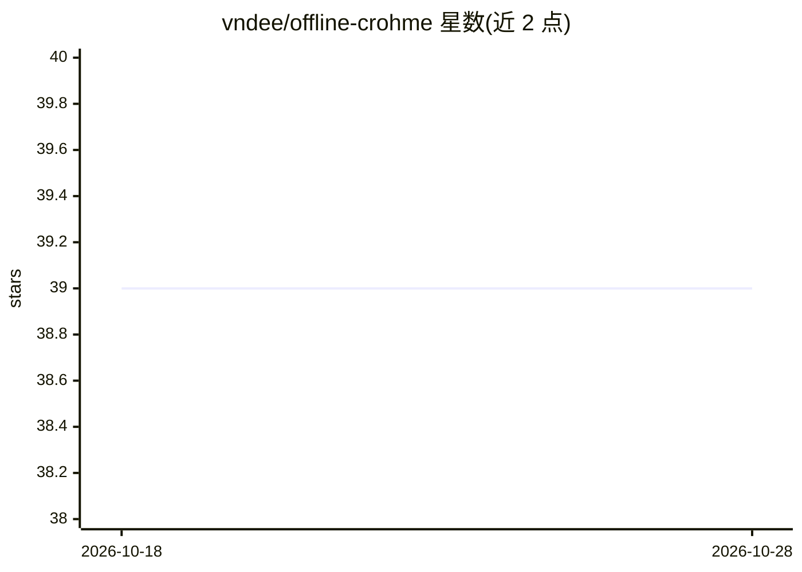

# vndee/offline-crohme

⭐ 39 · Python · MIT · 推送 2026-08-24 · [GitHub](https://github.com/vndee/offline-crohme) · 个人维护

**将 CROHME 在线手写数据集转为离线图像识别格式的工具**

数据预处理工具：读取 CROHME 手写数学表达式的 INKML 文件（在线笔迹信号），转换为图像文件与对应的 ground-truth LaTeX 文本文件，输出到 CROHME_processed 目录，用于构建离线手写识别数据集。运行方式为执行 python extract.py 单条命令。CROHME 数据集含 12000 余条表达式、来自多国书写者与多种采集设备。

## 筛选速览

| 维度 | 判定 | 备注 |
|---|---|---|
| AI 角色 | `ai-ecosystem` | LLM/agent 周边工具 |
| 许可风险 | `permissive` | MIT |
| 部署形态 | `None` |  |
| 模型依赖 | — | README 未给出锁定关系 |
| 硬件要求 | — | 无带数字的原话,不猜 |
| 安装摩擦 | `low` | 无编译、无系统依赖或容器化 |
| 成熟度 | — | 结构信号不足 |

## 能力要点

- INKML 在线笔迹转换为图像文件
- 生成与图像对应的 ground-truth LaTeX 文本
- 单命令 python extract.py 完成转换

## 适用场景

- 为离线手写数学表达式识别模型准备训练数据
- 将 CROHME 在线信号数据集转为图像格式

## 场景标签

 · 领域:深度学习/手写识别数据集

## 证据(README 行号)

> L2: **offline_CROHME** is a tool for converting CROHME to Offline-handwritting text recognition dataset. This tool help 
> L10: python extract.py

## 星数曲线

2026-10-18 39 → 2026-10-28 39（+0）

---
*卡片 v1 · prompt 1.4 · 生成 2026-10-25 · 置信度 mid · 依据 README sha `185e5b7a6bcc` · [字段定义](../../DATASET.md)*
