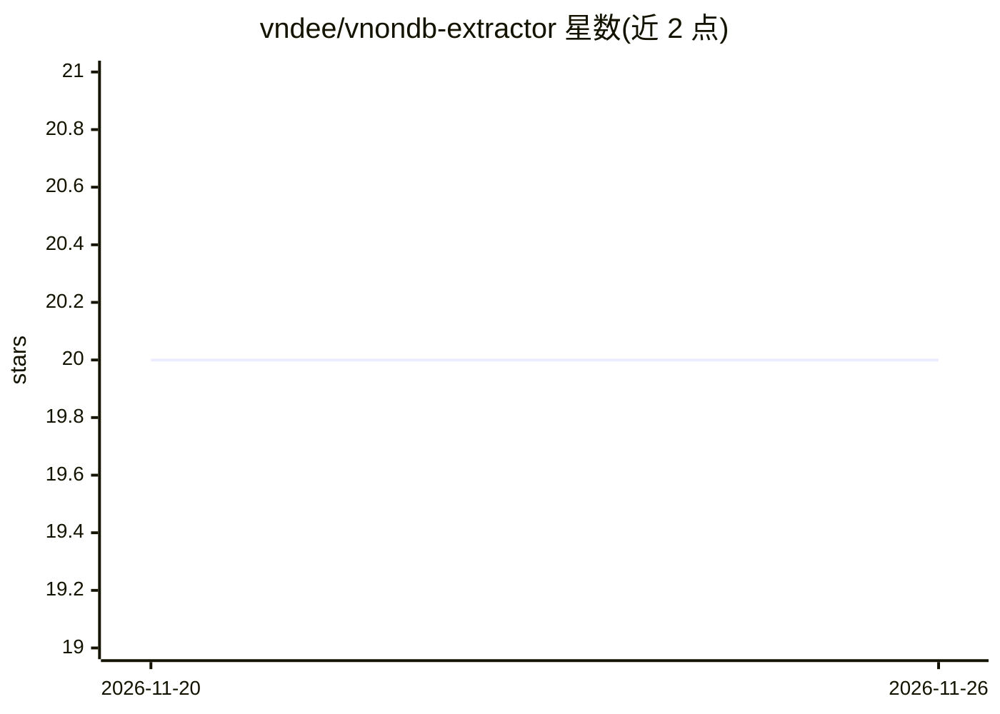

# vndee/vnondb-extractor

⭐ 20 · Python · MIT · 推送 2026-11-19 · [GitHub](https://github.com/vndee/vnondb-extractor) · [官网](https://sites.google.com/view/icfhr2018-vohtr-vnondb) · 个人维护

**把 VNOnDB 手写数据集转换为图片与文本标注的工具**

将 TUAT HANDS-VNOnDB 越南语手写数据集的 InkML 文件转换为 PNG 图像及对应 ground-truth 文本，按词、行、段落三个层级分别提供脚本处理。数据集本身包含 1,146 个段落、7,296 行、超过 48 万笔画，需先向 TUAT 申请授权获取，转换后数据不得再分发，仅限非商业科研教育用途；MIT 许可仅覆盖提取器代码本身。

## 筛选速览

| 维度 | 判定 | 备注 |
|---|---|---|
| AI 角色 | `ai-knowledge` | 知识聚合/清单类 |
| 许可风险 | `permissive` | MIT |
| 部署形态 | `library` | 以包/库形式分发 |
| 模型依赖 | — | README 未给出锁定关系 |
| 硬件要求 | — | 无带数字的原话,不猜 |
| 安装摩擦 | `low` | 无编译、无系统依赖或容器化 |
| 成熟度 | — | 结构信号不足 |

## 能力要点

- 将 InkML 文件转换为 PNG 图像与 ground-truth 文本
- 支持 word/line/paragraph 三种子集分别转换
- 数据集含 1,146 个段落、7,296 行、200 位书写者

## 适用场景

- 构建越南语手写文本识别的深度学习模型
- 在获得 TUAT 授权后本地处理 VNOnDB 数据

## 场景标签

 · 领域:数据集/数据预处理

## 证据(README 行号)

> L2: Converts VNOnDB InkML files to PNG images and ground-truth text.
> L12: HANDS-VNOnDB (VNOnDB in short) provides 1,146 Vietnamese paragraphs of handwritten text composed of 7,296 lines, mo

## 星数曲线

2026-11-20 20 → 2026-11-26 20（+0）

---
*卡片 v1 · prompt 1.4 · 生成 2026-11-20 · 置信度 high · 依据 README sha `1b3a371256f7` · [字段定义](../../DATASET.md)*
