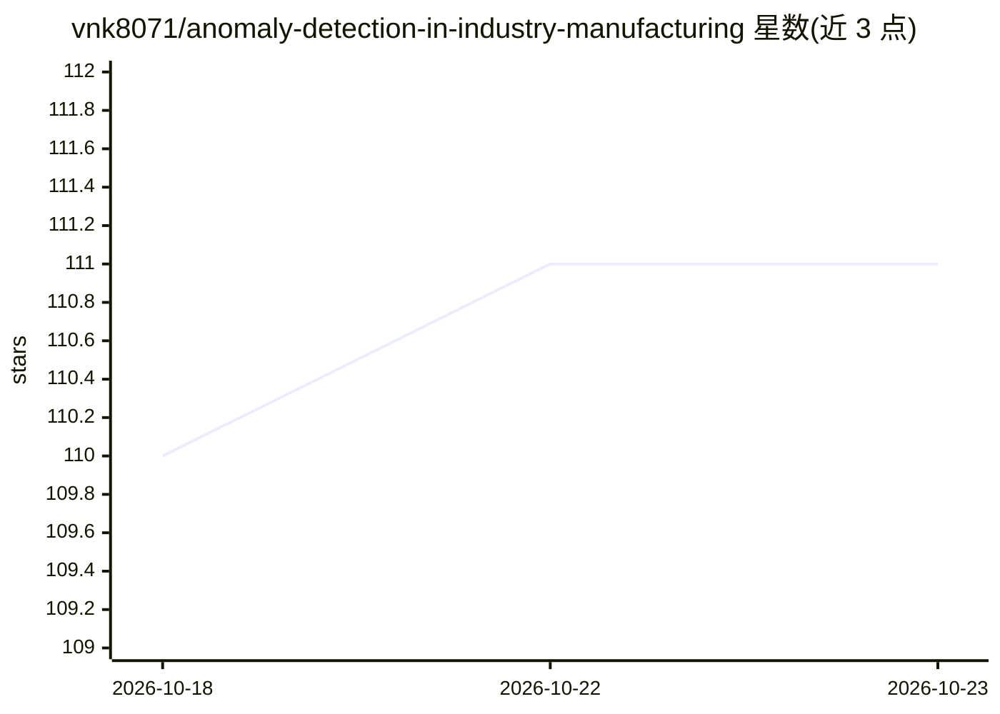

# vnk8071/anomaly-detection-in-industry-manufacturing

⭐ 111 · Python · 推送 2026-04-09 · [GitHub](https://github.com/vnk8071/anomaly-detection-in-industry-manufacturing) · 个人维护

**基于 Anomalib 的工业异常检测训练与推理管线，含 UI**

基于旧版 Anomalib API（pin anomalib==0.3.6）构建的工业图像异常检测流水线：支持 PatchCore 等模型在 MVTec AD 或自定义数据集（train/test/ground_truth 三目录结构）上训练、单图推理，并提供 PyTorch/ONNXRuntime/OpenVINO 三后端基准测试与 INT8 静态量化、OpenVINO PTQ 量化脚本。交付形态含 Gradio Demo、FastAPI 服务与 Docker/docker-compose 容器。README 声明项目基于 legacy API，升级新版 Anomalib 需改代码。评估功能标注 Coming soon。

## 筛选速览

| 维度 | 判定 | 备注 |
|---|---|---|
| AI 角色 | `ai-native` | 本体是模型或模型工具 |
| 许可风险 | `none` | — |
| 部署形态 | `self-host` | docker 或自建部署 |
| 模型依赖 | — | README 未给出锁定关系 |
| 硬件要求 | — | 无带数字的原话,不猜 |
| 安装摩擦 | `low` | 无编译、无系统依赖或容器化 |
| 成熟度 | — | 结构信号不足 |

## 能力要点

- PatchCore 等模型的训练与单图推理脚本
- PyTorch/ONNXRuntime/OpenVINO 多后端基准对比（含延迟分位数）
- ONNX 静态 INT8 量化与 OpenVINO PTQ 量化脚本
- Gradio Demo 与 FastAPI 服务，附 Docker 部署

## 适用场景

- 在 MVTec AD 或自定义工业图像数据上训练异常检测模型
- 对比不同推理后端（PyTorch/ONNXRuntime/OpenVINO）的推理速度
- 通过 Gradio/FastAPI 界面对图像做异常检测演示

## 场景标签

 · 领域:工业视觉/异常检测

## 证据(README 行号)

> L31: MVTec AD is a dataset for benchmarking anomaly detection methods with a focus on industrial inspection. It contains
> L75: python train.py --config "configs/patchcore_grid.yaml" --model "patchcore"
> L83: python script_inference.py --config "configs/patchcore_hazelnut.yaml" --weight "models/patchcore_hazelnut.ckpt" --i

## 星数曲线

2026-10-18 110 → 2026-10-23 111（+1）

---
*卡片 v1 · prompt 1.4 · 生成 2026-10-23 · 置信度 high · 依据 README sha `c4d91f26e8a8` · [字段定义](../../DATASET.md)*
