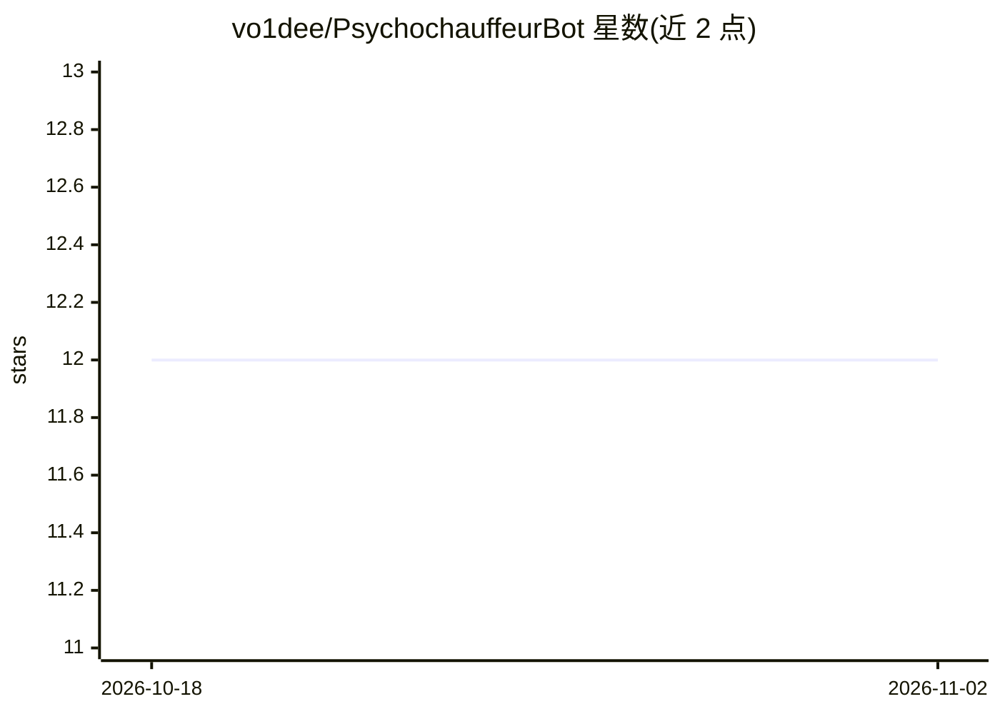

# vo1dee/PsychochauffeurBot

⭐ 12 · Python · 推送 2026-10-31 · [GitHub](https://github.com/vo1dee/PsychochauffeurBot) · [官网](http://vo1dee.com) · 个人维护

**多功能 Telegram 机器人：媒体下载、GPT 对话与实用工具**

面向 Telegram 群组与私聊的多功能机器人：从 TikTok、YouTube Shorts、Twitter/X、Twitch 等平台自动下载视频/图片（上限 50MB）并直接发送；通过 OpenRouter API 提供 GPT 对话（提及响应、/ask、/analyze 消息摘要与图片分析，模型 GPT-4-mini）；另含天气与 AI 建议、地磁活动跟踪、Speechmatics 语音转文字（可选）、内容审核、键盘布局转换、AliExpress 链接缩短等工具。部署需 Python 3.10+、Telegram Bot Token、OpenRouter API Key 与 PostgreSQL，支持 Docker 与手动安装，/analyze 结果带 24 小时缓存。

## 筛选速览

| 维度 | 判定 | 备注 |
|---|---|---|
| AI 角色 | `ai-enhanced` | 去掉 AI 部分产品仍成立 |
| 许可风险 | `none` | — |
| 部署形态 | `self-host` | docker 或自建部署 |
| 模型依赖 | locked-api |  |
| 硬件要求 | — | 无带数字的原话,不猜 |
| 安装摩擦 | `low` | 无编译、无系统依赖或容器化 |
| 成熟度 | — | 结构信号不足 |

## 能力要点

- 多平台视频/图片自动下载（TikTok/YouTube Shorts/Twitter/Twitch 等，50MB 上限）
- GPT 对话集成：提及响应、/ask、/analyze 摘要与图片分析，模型 GPT-4-mini
- Speechmatics 语音转文字（默认关闭，按聊天开启）
- /analyze 结果按聊天/时段/内容哈希缓存，默认 24 小时

## 适用场景

- 在 Telegram 群里直接下载社交平台视频并发送
- 让 bot 在聊天中回答问题、总结消息、转写语音
- 查询天气并获取 AI 建议、跟踪地磁活动

## 场景标签

`聊天机器人` `语音识别` · 领域:对话与助手

## 证据(README 行号)

> L5: A versatile Telegram bot that downloads videos and images from social media platforms, provides weather updates with
> L25: - **GPT Features**:
> L32: - **Model**: GPT-4-mini with optimized parameters

## 星数曲线

2026-10-18 12 → 2026-11-02 12（+0）

---
*卡片 v1 · prompt 1.4 · 生成 2026-10-31 · 置信度 mid · 依据 README sha `c66340183f7c` · [字段定义](../../DATASET.md)*
