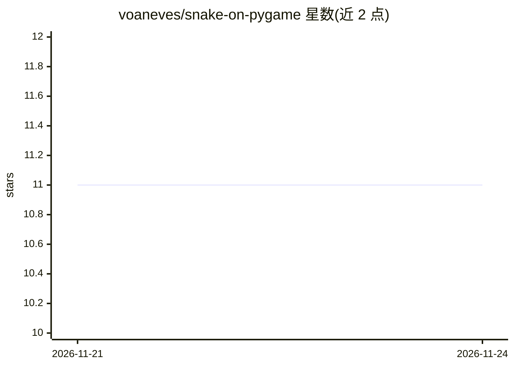

# voaneves/snake-on-pygame

⭐ 11 · Python · MIT · 推送 2026-11-20 · [GitHub](https://github.com/voaneves/snake-on-pygame) · [官网](https://voaneves.github.io/snake-on-pygame/) · 个人维护

**可用人类或 DQN 智能体操控的 Pygame 贪吃蛇游戏**

用 Python 和 Pygame 实现的经典贪吃蛇，提供单人游玩与 benchmark 两种模式（benchmark 模式玩 10 局并记录平均得分与步数，成绩可提交排行榜）。游戏类遵循 gym 风格 API，暴露 nb_actions、reset 等属性与方法，可在 PyTorch、TensorFlow、Theano 或 Keras 中接入自写智能体；配套 colab-rl 项目可直接运行 DQN。依赖 Python 3.4+ 与 pygame/numpy/pandas。

## 筛选速览

| 维度 | 判定 | 备注 |
|---|---|---|
| AI 角色 | `ai-enhanced` | 去掉 AI 部分产品仍成立 |
| 许可风险 | `permissive` | MIT |
| 部署形态 | `library` | 以包/库形式分发 |
| 模型依赖 | — | README 未给出锁定关系 |
| 硬件要求 | — | 无带数字的原话,不猜 |
| 安装摩擦 | `low` | 无编译、无系统依赖或容器化 |
| 成熟度 | — | 结构信号不足 |

## 能力要点

- gym 风格 API，支持接入 PyTorch/TensorFlow/Theano/Keras 智能体
- benchmark 模式记录 10 局平均得分与步数并可提交排行榜
- 配套 colab-rl 项目可直接运行 DQN 训练

## 适用场景

- 自己玩贪吃蛇并与 AI 智能体/人类的基准分数比较
- 为自己的强化学习智能体找一个 gym 风格的练习环境
- 用 colab-rl 跑 DQN 并调整超参数实验

## 场景标签

`强化学习` · 领域:训练与推理

## 证据(README 行号)

> L5:  Classic Snake in Python and Pygame, playable by a person or controlled by a DQN agent.
> L63: The game follows a gym-style API, so you can plug in any agent written in PyTorch, TensorFlow, Theano or Keras. To 

## 星数曲线

2026-11-21 11 → 2026-11-24 11（+0）

---
*卡片 v1 · prompt 1.4 · 生成 2026-11-21 · 置信度 mid · 依据 README sha `aa756a8e8799` · [字段定义](../../DATASET.md)*
