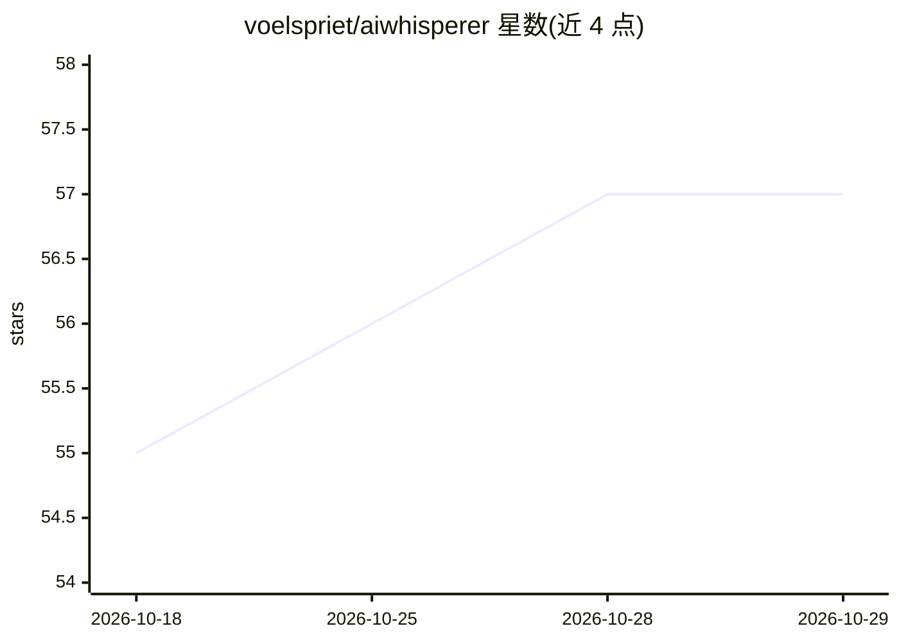

# voelspriet/aiwhisperer

⭐ 57 · Python · CC0-1.0 · 推送 2026-01-20 · [GitHub](https://github.com/voelspriet/aiwhisperer) · 个人维护

**调查文档上传云端 AI 前的本地脱敏与压缩工具**

面向需要把大型机密 PDF 交给云端 AI 分析的用户（调查记者、研究人员）：本地完成 PDF 转文本（含 OCR）、分块（每块 500 页），并用 spaCy NER + 正则 + 上下文模式识别人名、电话、IBAN、地址等 12 类敏感实体，替换为 PERSON_001 等占位符并保存 mapping.json；AI 分析完成后本地解码还原真实信息。支持荷/英/德/法/意/西 6 种语言的 NER 模型，提供 replace/redact/mask/hash 四种脱敏策略与 --dry-run 预览。README 明确声明检测非 100% 准确，要求上传前人工核查输出。提供 macOS dmg（Apple Silicon，未签名）与 pip 安装两种途径。

## 筛选速览

| 维度 | 判定 | 备注 |
|---|---|---|
| AI 角色 | `ai-native` | 本体是模型或模型工具 |
| 许可风险 | `viral` | CC0-1.0 |
| 部署形态 | `desktop` | 安装包/桌面程序 |
| 模型依赖 | — | README 未给出锁定关系 |
| 硬件要求 | — | 无带数字的原话,不猜 |
| 安装摩擦 | `low` | 无编译、无系统依赖或容器化 |
| 成熟度 | — | 结构信号不足 |

## 能力要点

- spaCy NER + 模式匹配 + 上下文标记三层检测，覆盖 12 类敏感实体（人名/电话/IBAN/身份证号等）
- 本地编码→云端分析→本地解码的工作流，保存 mapping.json 可逆还原
- PDF 转 OCR 文本并按 500 页分块，实测 4,713 页文件转为 13.8 MB（缩小 92%）
- 4 种脱敏策略（replace/redact/mask/hash）与 --dry-run 预览

## 适用场景

- 把超大调查案卷转文本、分块后交给 NotebookLM 等云端 AI 做时间线与关系分析
- 机密文档上传前脱敏以降低敏感数据暴露风险
- 多份文档复用同一映射表保持占位符一致，便于交叉比对

## 场景标签

`OCR` `文档解析` · 领域:知识与检索

## 证据(README 行号)

> L203: |**PERSON**|`Jan de Vries`, `El Mansouri Brahim`|Names via NER + context patterns|
> L262: 1. **spaCy NER** - Context-aware name/location detection

## 星数曲线

2026-10-18 55 → 2026-10-29 57（+2）

---
*卡片 v1 · prompt 1.4 · 生成 2026-10-24 · 置信度 high · 依据 README sha `c4a28f05c582` · [字段定义](../../DATASET.md)*
