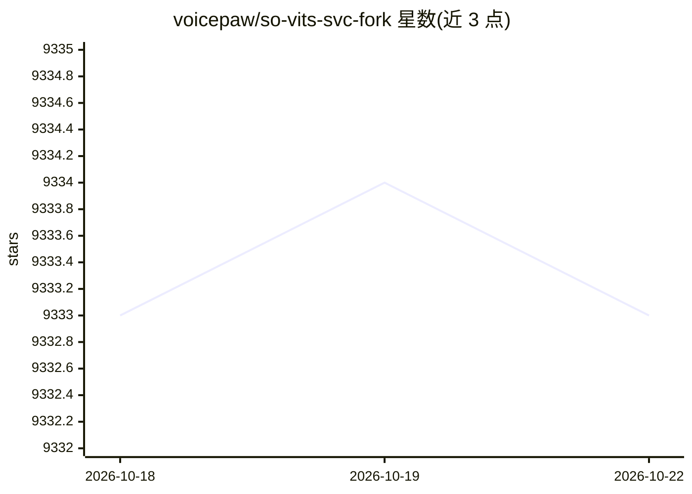

# voicepaw/so-vits-svc-fork

⭐ 9,329 · Python · NOASSERTION · 推送 2026-10-22 · [GitHub](https://github.com/voicepaw/so-vits-svc-fork) · 组织维护 · 中文 README

**歌声/语音转换工具：实时变声与模型训练，已停止维护**

so-vits-svc 的 fork，基于 ContentVec/HuBERT 特征与 VITS、PyTorch Lightning 实现，提供实时麦克风变声（svc vc）、文件推理（svc infer）、GUI（svcg）及完整训练流程（预处理、HuBERT 特征提取、训练）。训练支持 CREPE 音高估计、QuickVC 集成、自动下载预训练模型。通过 pip/pipx 安装，GPU 推理需 4GB 显存、训练需 4GB+，支持 CUDA/ROCm/MPS。README 明确声明不再维护（L33），并列出 RVC 系、DDSP-SVC 等替代项目。

## 筛选速览

| 维度 | 判定 | 备注 |
|---|---|---|
| AI 角色 | `ai-native` | 本体是模型或模型工具 |
| 许可风险 | `none` | NOASSERTION |
| 部署形态 | `library` | 以包/库形式分发 |
| 模型依赖 | — | README 未给出锁定关系 |
| 硬件要求 | — | 无带数字的原话,不猜 |
| 安装摩擦 | `medium` | 含编译或系统依赖之一 |
| 成熟度 | — | 结构信号不足 |

## 能力要点

- 实时麦克风变声与 GUI/统一 CLI
- 训练速度约为原版 2 倍，自动下载预训练模型
- 支持 CREPE 音高估计与 QuickVC（MS-iSTFT Decoder）
- 提供 Colab/Paperspace 云端训练入口

## 适用场景

- 实时变声（直播、语音聊天）
- 用自己收集的音频数据训练个人音色模型
- 对音频文件做歌声/语音转换

## 场景标签

 · 领域:音频/语音转换

## 证据(README 行号)

> L31: A fork of `so-vits-svc` with **realtime support** and **greatly improved interface**. Based on branch `4.0` (v1) (o
> L63: - **Realtime voice conversion** (enhanced in v1.1.0)

## 星数曲线

2026-10-18 9,333 → 2026-10-22 9,333（+0）

---
*卡片 v1 · prompt 1.4 · 生成 2026-10-20 · 置信度 high · 依据 README sha `4a8f9392afa6` · [字段定义](../../DATASET.md)*
