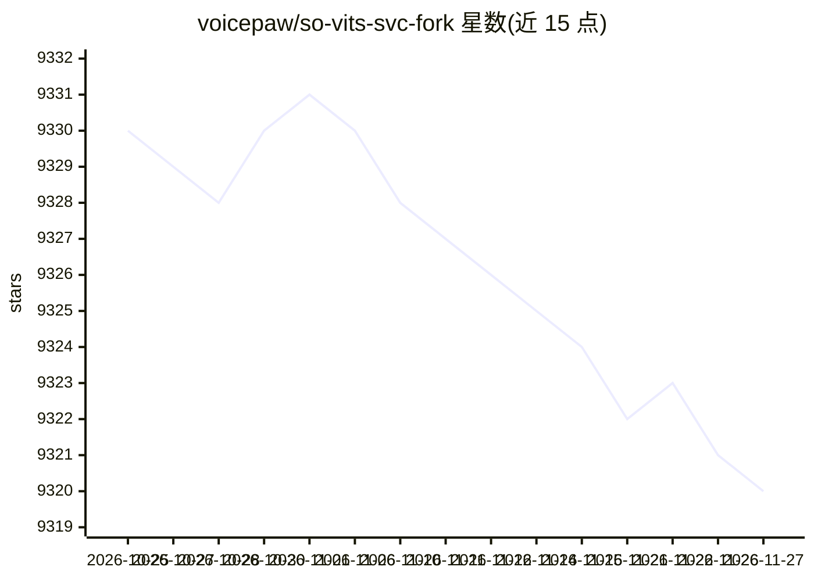

# voicepaw/so-vits-svc-fork

⭐ 9,320 · Python · NOASSERTION · 推送 2026-11-19 · [GitHub](https://github.com/voicepaw/so-vits-svc-fork) · 个人维护 · 中文 README

**so-vits-svc 的 fork：给想要实时歌声转换的用户提供易装易用的语音转换工具**

基于 so-vits-svc 4.0 分支的 fork，提供实时语音转换、GUI 与统一 CLI、CREPE 音高估计、约 2 倍训练速度提升；pip 安装即可用，自动下载预训练模型而无需安装 fairseq。模型与 4.0/4.1 分支兼容，但不支持其他模型。面向想进行歌声/语音转换的用户。注意：项目自 2023 年春起仅限维护性更新，现已声明不再维护并给出替代项目清单。训练建议至少 4GB VRAM，推理需至少 4GB VRAM，Windows 上 AMD GPU 不受支持。

## 筛选速览

| 维度 | 判定 | 备注 |
|---|---|---|
| AI 角色 | `ai-native` | 本体是模型或模型工具 |
| 许可风险 | `none` | NOASSERTION |
| 部署形态 | `library` | 以包/库形式分发 |
| 模型依赖 | — | README 未给出锁定关系 |
| 硬件要求 | — | 无带数字的原话,不猜 |
| 安装摩擦 | `medium` | 含编译或系统依赖之一 |
| 成熟度 | — | 结构信号不足 |

## 能力要点

- 实时语音转换（麦克风输入，svc vc 命令）
- GUI（svcg）与统一 CLI（svc）双入口
- pip 安装即用，自动下载预训练模型，无需 fairseq
- CREPE 音高估计与 ContentVec 修正、部分集成 QuickVC

## 适用场景

- 实时把自己的歌声/语音转换成目标音色
- 用自己的数据集训练歌声转换模型
- 对 wav 文件做离线推理转换

## 场景标签

`微调` · 领域:训练与推理

## 证据(README 行号)

> L31: A fork of `so-vits-svc` with **realtime support** and **greatly improved interface**. Based on branch `4.0` (v1) (o
> L63: - **Realtime voice conversion** (enhanced in v1.1.0)

## 星数曲线

2026-10-25 9,330 → 2026-11-27 9,320（-10）

---
*卡片 v1 · prompt 1.4 · 生成 2026-11-22 · 置信度 high · 依据 README sha `06742d67bbd9` · [字段定义](../../DATASET.md)*
