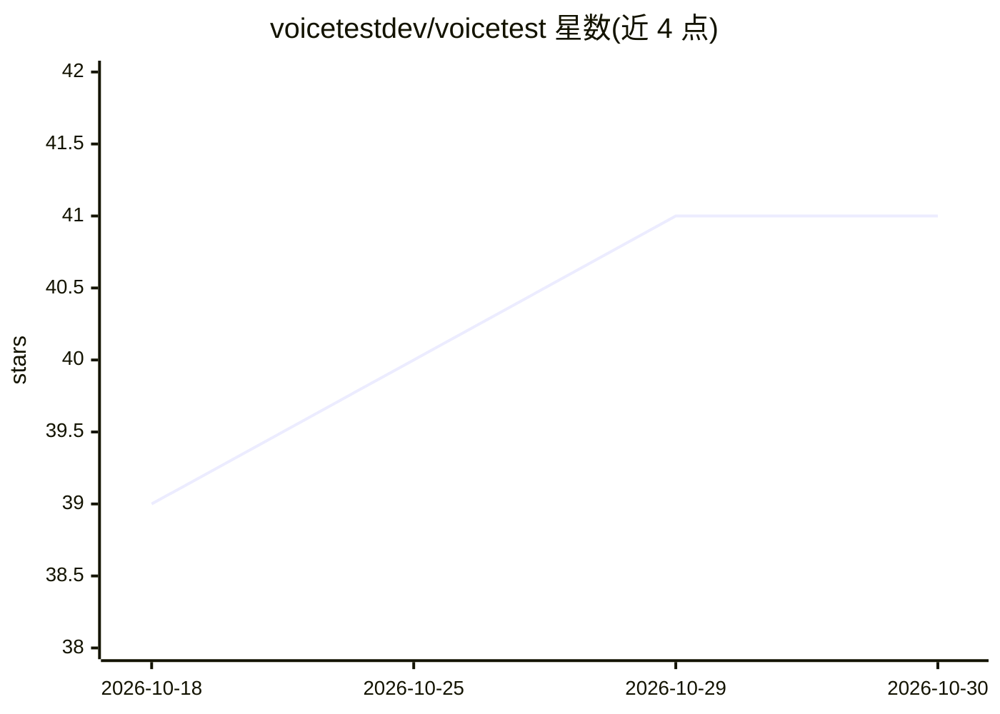

# voicetestdev/voicetest

⭐ 41 · Python · Apache-2.0 · 推送 2026-10-21 · [GitHub](https://github.com/voicetestdev/voicetest) · [官网](https://voicetest.dev) · 组织维护

**语音 agent 工作流的开源测试工具**

面向语音 agent 开发者的测试框架：用 LLM 驱动的模拟用户与 agent 对话，再由 LLM 裁判打分；支持从 Retell、VAPI、Bland、Telnyx、LiveKit 导入 agent，经统一 AgentGraph 中间表示实现平台间格式转换；内置 LLM 修复循环诊断失败用例，支持 CLI、Web UI、REST API 与 CI/GitHub Actions 集成。模型层兼容任意 LiteLLM 可用后端（OpenAI、Anthropic、Groq、Ollama 等）。以 Python 包经 uv/pip 安装。

## 筛选速览

| 维度 | 判定 | 备注 |
|---|---|---|
| AI 角色 | `ai-ecosystem` | LLM/agent 周边工具 |
| 许可风险 | `permissive` | Apache-2.0 |
| 部署形态 | `library` | 以包/库形式分发 |
| 模型依赖 | local-ok | 支持本地模型 |
| 硬件要求 | — | 无带数字的原话,不猜 |
| 安装摩擦 | `low` | 无编译、无系统依赖或容器化 |
| 成熟度 | — | 结构信号不足 |

## 能力要点

- LLM 模拟用户对话并由 LLM 裁判评分的自动化仿真测试
- Retell/VAPI/Bland/Telnyx/LiveKit 五平台导入导出与统一 AgentGraph 转换
- LLM 修复循环自动诊断并修复失败 prompt
- CLI / Web UI / REST API / GitHub Actions 多种运行方式

## 适用场景

- 语音 agent 上线前跑自动化回归测试
- 把 agent 配置从一个语音平台迁移到另一个
- 在 CI 中拦截语音 agent 的行为退化

## 场景标签

`模型评测` · 领域:评测与运维

## 证据(README 行号)

> L7: - **Simulate conversations** — LLM-powered users talk to your agent, LLM judges score the results
> L8: - **Test any platform** — Retell, VAPI, LiveKit, Bland, Telnyx, or custom agents
> L96: Any LiteLLM-compatible model works — OpenAI, Anthropic, Google, Ollama, and more. See the full configuration refere

## 星数曲线

2026-10-18 39 → 2026-10-30 41（+2）

---
*卡片 v1 · prompt 1.4 · 生成 2026-10-25 · 置信度 high · 依据 README sha `f6e8c9f4248b` · [字段定义](../../DATASET.md)*
