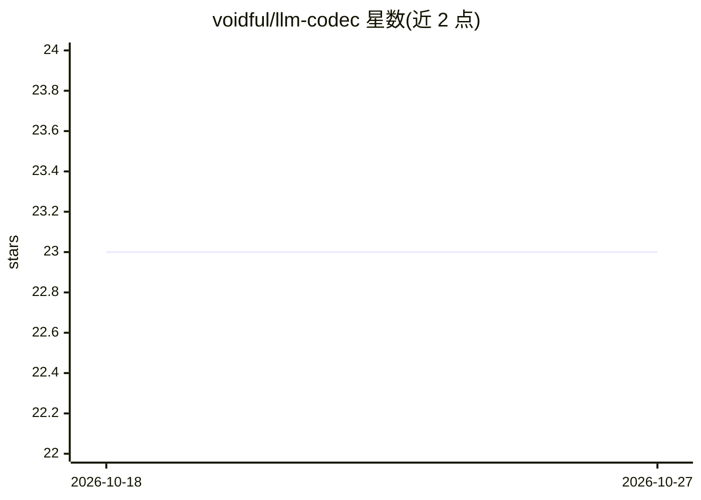

# voidful/llm-codec

⭐ 23 · Python · 推送 2026-05-03 · [GitHub](https://github.com/voidful/llm-codec) · [官网](http://eric-lam.com/llm-codec/) · 个人维护

**训练框架：微调神经音频编解码器使其 token 更易被 LM 预测**

用于神经音频编解码器微调的训练框架：在以 AUV 为基础 codec、Qwen3-4B-Instruct 为冻结 LM 骨干的设置下，加入面向 LM 的训练目标（FTP 未来 token 预测头、SA 语义对齐损失、可微 Gumbel 桥），同时保留 mel/STFT/GAN 等重建损失以稳定波形质量；部署时 codec 架构与推理成本不变。仓库包含训练循环、检查点导出与上传 Hugging Face Hub 的脚本，并附训练配方与网页音频示例生成；论文中的下游评测管线（SALMon、token-LM 困惑度评测等）不在本仓库内。需 CUDA 环境运行。

## 筛选速览

| 维度 | 判定 | 备注 |
|---|---|---|
| AI 角色 | `ai-native` | 本体是模型或模型工具 |
| 许可风险 | `none` | — |
| 部署形态 | `library` | 以包/库形式分发 |
| 模型依赖 | — | README 未给出锁定关系 |
| 硬件要求 | — | 无带数字的原话,不猜 |
| 安装摩擦 | `medium` | 含编译或系统依赖之一 |
| 成熟度 | — | 结构信号不足 |

## 能力要点

- FTP（Medusa 式多头预测未来音频 token）与 SA（语音-文本表征对齐）两项 LM 面向损失
- 可微 Gumbel 桥保持离散 token 前向的同时回传梯度至 codec 编码器
- 重建保持训练：mel、多尺度 mel、多分辨率 STFT、VQ、MPD/MSD GAN 与特征匹配损失
- 提供 25k 步训练脚本、检查点导出与 Hugging Face Hub 上传脚本

## 适用场景

- 为口语语言模型训练更易预测的音频 codec token
- 在保持波形重建质量的前提下降低 codec token 困惑度
- 复现论文训练流程并导出模型到 Hugging Face Hub

## 场景标签

`微调` · 领域:训练与推理

## 证据(README 行号)

> L3: LLM-Codec is a training framework for adapting a neural audio codec so its
> L13: This repository currently contains the codec training and checkpoint export
> L48: Training uses AUV as the base codec and Qwen3-4B-Instruct as the frozen LM

## 星数曲线

2026-10-18 23 → 2026-10-27 23（+0）

---
*卡片 v1 · prompt 1.4 · 生成 2026-10-27 · 置信度 high · 依据 README sha `d58240b5ad13` · [字段定义](../../DATASET.md)*
