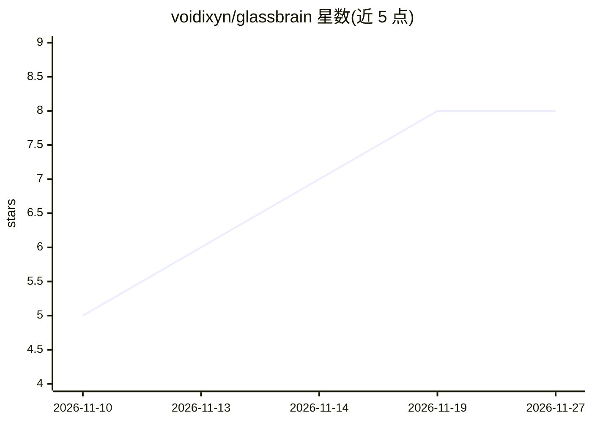

# voidixyn/glassbrain

⭐ 8 · TypeScript · MIT · 推送 2026-11-10 · [GitHub](https://github.com/voidixyn/glassbrain) · [官网](https://voidixyn.github.io/glassbrain/) · 个人维护

**查看与比对 agent 知识图谱的可视化与 diff 工具**

glassbrain 读取 agent 生成的知识图谱（两个数组的 JSON 格式），渲染为单个独立 HTML 文件供人浏览；支持基于包含关系的稳定布局、版本快照逐步回放、两版并排比对以及与 git 提交的 diff。提供 CLI（npx 调用）、React 组件嵌入两种使用方式，并附带 kg-build、docs-to-kg 等可安装到 agent 的 SKILL.md 技能。工具本身不构建图谱，由用户的 agent 生成；兼容打开 Graphify、Understand-Anything、MCP memory server、Obsidian vault 等来源的已有图谱。MIT 许可。

## 筛选速览

| 维度 | 判定 | 备注 |
|---|---|---|
| AI 角色 | `ai-ecosystem` | LLM/agent 周边工具 |
| 许可风险 | `permissive` | MIT |
| 部署形态 | `library` | 以包/库形式分发 |
| 模型依赖 | — | README 未给出锁定关系 |
| 硬件要求 | — | 无带数字的原话,不猜 |
| 安装摩擦 | `low` | 无编译、无系统依赖或容器化 |
| 成熟度 | — | 结构信号不足 |

## 能力要点

- 两数组 JSON 格式，agent 无需 SDK 即可写出；CLI 提供 validate/strict/--json 结构化校验输出
- 包含式稳定布局：图谱变更时未变节点保持位置，支持版本快照回放与两版并排像素对齐比对
- npx glassbrain diff 与任意 git 提交比较图谱变化
- 可直接打开 Graphify、Understand-Anything、MCP memory server、Obsidian vault 等格式的已有图谱并转换

## 适用场景

- 查看 agent 构建的代码库记忆或文档知识图谱
- 比对 agent 两次运行之间知识图谱的变化
- 将已有 Graphify/MCP memory/Obsidian 图谱打开为可浏览页面
- 在自研 React 应用中嵌入图谱浏览与 diff 组件

## 场景标签

`知识图谱` · 领域:知识与检索

## 证据(README 行号)

> L79: glassbrain does not build graphs; your agent does. Because the format is two arrays and the CLI
> L145:  Skill-free and model-agnostic — any agent that can run terminal commands can use it.

## 星数曲线

2026-11-10 5 → 2026-11-27 8（+3）

---
*卡片 v1 · prompt 1.4 · 生成 2026-11-20 · 置信度 high · 依据 README sha `5423cee199ae` · [字段定义](../../DATASET.md)*
