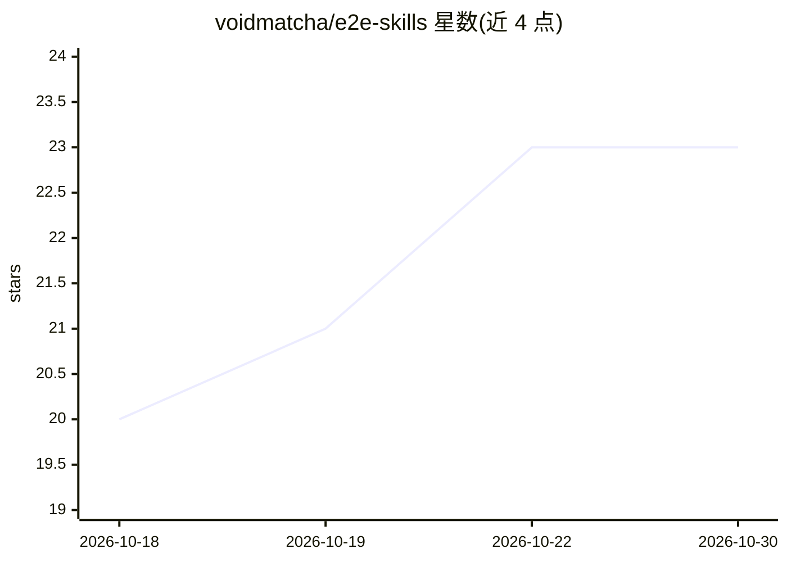

# voidmatcha/e2e-skills

⭐ 23 · Python · Apache-2.0 · 推送 2026-10-28 · [GitHub](https://github.com/voidmatcha/e2e-skills) · [官网](https://voidmatcha.art/talks/awskrug-e2e-2026-en) · 个人维护 · 中文 README

**供 AI 编码 agent 使用的 Playwright/Cypress E2E 测试技能包**

为 Claude Code、Codex 及其他兼容 AI 编码 agent 提供四个开源技能：playwright-test-generator 基于观察到的页面生成 Playwright 测试；e2e-reviewer 用代码扫描器先找可疑断言再读代码判定真伪，可做断言变异或注入 bug 验证测试是否会失败；playwright-debugger 与 cypress-debugger 用 F1–F15 类别标注 15 类失败原因并给出修复建议。问题按 P0/P1/P2 分级。安装方式包括 install.sh、npx CLI、skills.sh 与双平台插件市场；原生 Windows 不支持，需 WSL。

## 筛选速览

| 维度 | 判定 | 备注 |
|---|---|---|
| AI 角色 | `ai-ecosystem` | LLM/agent 周边工具 |
| 许可风险 | `permissive` | Apache-2.0 |
| 部署形态 | `library` | 以包/库形式分发 |
| 模型依赖 | — | README 未给出锁定关系 |
| 硬件要求 | — | 无带数字的原话,不猜 |
| 安装摩擦 | `low` | 无编译、无系统依赖或容器化 |
| 成熟度 | — | 结构信号不足 |

## 能力要点

- 四个技能覆盖 Playwright 测试生成、Playwright/Cypress 测试审查与失败调试
- e2e-reviewer 先静态扫描再读代码判定问题真伪，可做断言变异与故障注入验证
- P0/P1/P2 分级与 F1–F15 失败类别标注，附带无需安装目标项目依赖的 scan.sh
- 其审查发现促成 15 个上游仓库的已合并 PR

## 适用场景

- 让 Claude Code/Codex 为本地 Playwright 项目生成 E2E 测试
- 审查现有 Playwright/Cypress 测试或 PR 中可以通过但未验证行为的断言
- 调试失败的 Playwright/Cypress 运行并定位原因

## 场景标签

`代码审查` `代码生成` · 领域:编码与开发

## 证据(README 行号)

> L17: `e2e-skills` provides four open-source skills for Playwright and Cypress end-to-end (E2E) testing with Claude Code,
> L116: To include test generation, paste the prompt below into Claude Code or Codex and identify your existing local Play
> L137: npx --yes --package=@voidmatcha/e2e-skills-scanner@3.2.1 e2e-skills install --host codex --project /path/to/playwr

## 星数曲线

2026-10-18 20 → 2026-10-30 23（+3）

---
*卡片 v1 · prompt 1.4 · 生成 2026-10-27 · 置信度 high · 依据 README sha `7bdbd148e6a3` · [字段定义](../../DATASET.md)*
