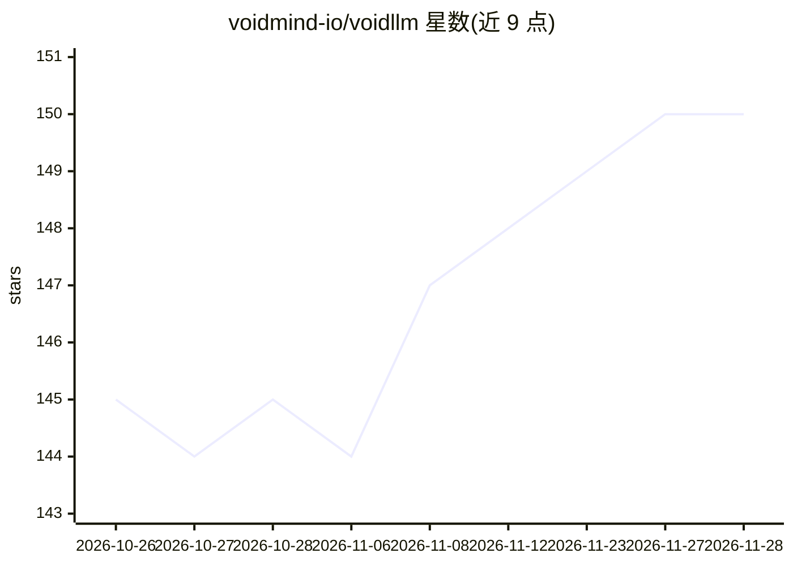

# voidmind-io/voidllm

⭐ 150 · Go · NOASSERTION · 推送 2026-11-24 · [GitHub](https://github.com/voidmind-io/voidllm) · [官网](https://voidllm.ai) · 组织维护

**给自托管 LLM 团队提供零日志的代理网关与密钥管理**

用 Go 编写的自托管 LLM 代理，部署在应用与各模型提供方之间。应用以 OpenAI 兼容接口调用，代理负责密钥认证、RBAC、速率限制、令牌预算、模型别名解析与多部署负载均衡/故障转移，并对接 OpenAI、Anthropic、Azure、Gemini、Vertex AI、Bedrock、Ollama、vLLM 或自定义端点。架构上不存储任何提示词与响应内容，仅记录元数据（调用者、模型、token 数、时延）。另提供 MCP 网关、WASM 沙箱 Code Mode、Web 控制台与 Prometheus 指标。付费版提供跨组织分析、SSO/OIDC、审计日志等功能。

## 筛选速览

| 维度 | 判定 | 备注 |
|---|---|---|
| AI 角色 | `ai-ecosystem` | LLM/agent 周边工具 |
| 许可风险 | `none` | NOASSERTION |
| 部署形态 | `desktop` | 安装包/桌面程序 |
| 模型依赖 | local-ok | 支持本地模型 |
| 硬件要求 | — | 无带数字的原话,不猜 |
| 安装摩擦 | `low` | 无编译、无系统依赖或容器化 |
| 成熟度 | — | 结构信号不足 |

## 能力要点

- 零知识架构：提示词与响应内容不落盘，仅记录元数据
- 多提供方路由、负载均衡与自动故障转移
- Org/Team/User/Key 四级 RBAC 与速率限制、令牌预算
- MCP 网关与 WASM 沙箱 Code Mode 编排多工具调用

## 适用场景

- 团队统一管理多个 LLM 提供方的密钥、预算与用量
- 合规场景下需要不记录提示词的自托管代理
- 多个 vLLM/Ollama 部署之间做负载均衡与故障转移
- 为编码代理提供 Anthropic/OpenAI 原生接口转发

## 场景标签

`模型网关` · 领域:Agent 开发

## 证据(README 行号)

> L15: VoidLLM is a self-hosted LLM proxy that sits between your applications and LLM providers - OpenAI, Anthropic, Azure
> L122: |Multi-provider routing|OpenAI, Anthropic, Azure, Gemini, Vertex AI, AWS Bedrock, Ollama, vLLM, any custom endpoin

## 星数曲线

2026-10-26 145 → 2026-11-28 150（+5）

---
*卡片 v1 · prompt 1.4 · 生成 2026-11-27 · 置信度 high · 依据 README sha `34e0c163e34a` · [字段定义](../../DATASET.md)*
