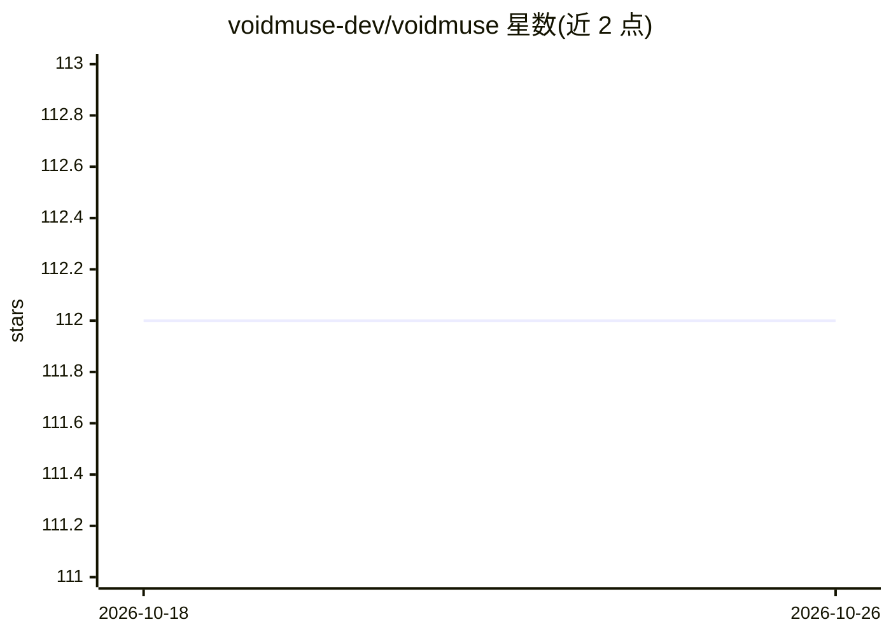

# voidmuse-dev/voidmuse

⭐ 112 · TypeScript · Apache-2.0 · 推送 2025-11-10 · [GitHub](https://github.com/voidmuse-dev/voidmuse) · [官网](https://voidmuse-dev.github.io/voidmuse/) · 个人维护 · 中文 README

**面向 IntelliJ 与 VS Code 的开源 AI IDE 插件**

适配 IntelliJ IDEA 与 VS Code 的开源 AI IDE 插件，提供智能代码补全、本地向量化的代码库索引与语义检索、多模型 AI 对话（OpenAI GPT、Anthropic Claude、DeepSeek、OpenRouter）、MCP 协议支持与搜索集成（Google/博查）。项目同时定位为学习型 AI 工程化平台，附技术原理文档、学习路径与外部课程汇总，基于 20+ 开源组件（Ant Design、TipTap、Vercel ai-sdk 等）构建。Apache-2.0 许可，GUI 内含页面停留时长埋点。

## 筛选速览

| 维度 | 判定 | 备注 |
|---|---|---|
| AI 角色 | `ai-ecosystem` | LLM/agent 周边工具 |
| 许可风险 | `permissive` | Apache-2.0 |
| 部署形态 | `None` |  |
| 模型依赖 | locked-api |  |
| 硬件要求 | — | 无带数字的原话,不猜 |
| 安装摩擦 | `low` | 无编译、无系统依赖或容器化 |
| 成熟度 | — | 结构信号不足 |

## 能力要点

- 智能代码补全（上下文感知、多语言）
- 本地向量数据库的代码库索引与语义检索
- 多模型 AI 对话：OpenAI / Anthropic / DeepSeek / OpenRouter
- MCP 协议支持与 Google/博查搜索集成

## 适用场景

- 在 IDE 中获得 AI 代码补全与代码库语义检索
- 配置多个模型 API 密钥进行 AI 对话
- 通过项目文档与实践路径学习 AI 工程化（Embedding、向量数据库等）

## 场景标签

`代码生成` `聊天机器人` `语义搜索` · 领域:编码与开发

## 证据(README 行号)

> L7: 🚀 **开源驱动的智能AI IDE插件** | **学习型AI工程化项目**
> L9: 适配 IntelliJ IDEA & Visual Studio Code
> L136: ### 💬 多模型AI对话 (AI Chat)

## 星数曲线

2026-10-18 112 → 2026-10-26 112（+0）

---
*卡片 v1 · prompt 1.4 · 生成 2026-10-23 · 置信度 high · 依据 README sha `e1b10a16e7bd` · [字段定义](../../DATASET.md)*
