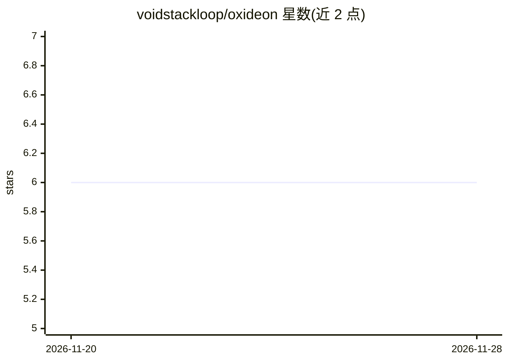

# voidstackloop/oxideon

⭐ 6 · Rust · Apache-2.0 · 推送 2026-11-27 · [GitHub](https://github.com/voidstackloop/oxideon) · 个人维护

**Rust 实现的张量与动态神经网络深度学习库**

以 Rust 实现的深度学习与张量库，核心 crate 为 oxideon-core，提供多精度张量（f32/f16/bf16/fp8 等）、零拷贝跨步视图、高阶自动微分、分块 GEMM 与缓存缓冲池。执行层通过 wgpu（Vulkan/DX12/Metal）与 NVIDIA CUDA PTX 动态加载运行，含 SSA 图编译器与算子融合。提供 PyO3 abi3 Python 绑定，一个 wheel 覆盖 Python 3.9–3.13，并给出 nn.Module、AdamW、DDP/FSDP 分布式、GGUF 量化与 LoRA/DPO 等训练推理组件。安装方式为 git clone 源码构建，License 为双许可。

## 筛选速览

| 维度 | 判定 | 备注 |
|---|---|---|
| AI 角色 | `ai-native` | 本体是模型或模型工具 |
| 许可风险 | `permissive` | Apache-2.0 |
| 部署形态 | `None` |  |
| 模型依赖 | local-ok | 支持本地模型 |
| 硬件要求 | — | 无带数字的原话,不猜 |
| 安装摩擦 | `medium` | 含编译或系统依赖之一 |
| 成熟度 | — | 结构信号不足 |

## 能力要点

- 多精度张量、零拷贝 strided 视图与 1–3 阶自动微分（Jacobian/Hessian）
- wgpu（Vulkan/DX12/Metal）与 CUDA PTX 动态加载双后端，SSA 图编译器与算子融合
- PyO3 abi3 Python 绑定，与 NumPy/PyTorch 经 DLPack 零拷贝互操作
- 内置 GGUF/1.58-bit/4-bit 量化、PagedAttention、FlashAttention-2 与 DDP/FSDP 分布式

## 适用场景

- 用 Rust 构建和训练神经网络而不写 C++/CUDA
- 在 Python 中以 PyTorch 风格 API 使用 Rust 张量后端
- 加载 GGUF 量化模型并做 LLM 推理与 PEFT 微调
- 与 NumPy/PyTorch/Pandas 等现有数据栈互操作

## 场景标签

`微调` `模型量化` · 领域:训练与推理

## 证据(README 行号)

> L3: **A fast, Hackable Deep Learning & Tensor Library in Rust — with a PyTorch-friendly Python API.**
> L18: - **A clean Rust core (`oxideon-core`)** with multi-dtype tensors (`f32`, `f64`, `f16`, `bf16`, `fp8`, `c64`, `c128

## 星数曲线

2026-11-20 6 → 2026-11-28 6（+0）

---
*卡片 v1 · prompt 1.4 · 生成 2026-11-20 · 置信度 high · 依据 README sha `df3ddefc6e9d` · [字段定义](../../DATASET.md)*
