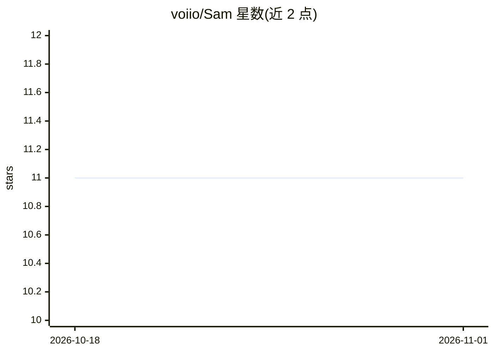

# voiio/Sam

⭐ 11 · Python · BSD-3-Clause · 推送 2026-10-27 · [GitHub](https://github.com/voiio/Sam) · [官网](https://code.voiio.de/Sam/) · 组织维护

**部署在 Slack 的 AI 同事机器人，代查资料、发邮件、建 Issue**

Sam 是运行在公司 Slack 工作区内的 AI 机器人：通过网页搜索、浏览网站、检索公司产品、读取内部文档、发送邮件、创建 GitHub issue 等方式协助员工。后端接入 OpenWebUI 运行 AI 模型，并使用 OpenAI Assistant API 对 ChatGPT 做针对性格特征、领域知识与公司上下文的定制。安装流程为搭建 OpenWebUI、克隆仓库、配置 .env 后用 docker-compose 启动，再按步骤创建 Slack App 并配置令牌。

## 筛选速览

| 维度 | 判定 | 备注 |
|---|---|---|
| AI 角色 | `ai-native` | 本体是模型或模型工具 |
| 许可风险 | `permissive` | BSD-3-Clause |
| 部署形态 | `self-host` | docker 或自建部署 |
| 模型依赖 | — | README 未给出锁定关系 |
| 硬件要求 | — | 无带数字的原话,不猜 |
| 安装摩擦 | `low` | 无编译、无系统依赖或容器化 |
| 成熟度 | — | 结构信号不足 |

## 能力要点

- Slack 工作区内的 AI 机器人，全员可用
- 能力覆盖网页搜索、网站浏览、内部文档阅读、发邮件、创建 GitHub issue
- 基于 OpenWebUI 运行模型，OpenAI Assistant API 定制性格与公司上下文
- 通过 docker-compose 部署，附 Slack App manifest 配置流程

## 适用场景

- 在 Slack 里向 AI 同事提问并让它代为检索与发邮件
- 让机器人读取内部文档回答公司相关问题
- 自动创建 GitHub issue 处理团队事务

## 场景标签

`AI 助手` `聊天机器人` · 领域:对话与助手

## 证据(README 行号)

> L9: Sam is an AI-powered co-worker to empower all your colleagues.
> L48: Sam is a Slack bot that OpenWebUI's AI models to provide a work-colleague like
> L53: Sam uses OpenAI's assistant API to fine-tune ChatGPT to:

## 星数曲线

2026-10-18 11 → 2026-11-01 11（+0）

---
*卡片 v1 · prompt 1.4 · 生成 2026-11-01 · 置信度 mid · 依据 README sha `f1710272535a` · [字段定义](../../DATASET.md)*
