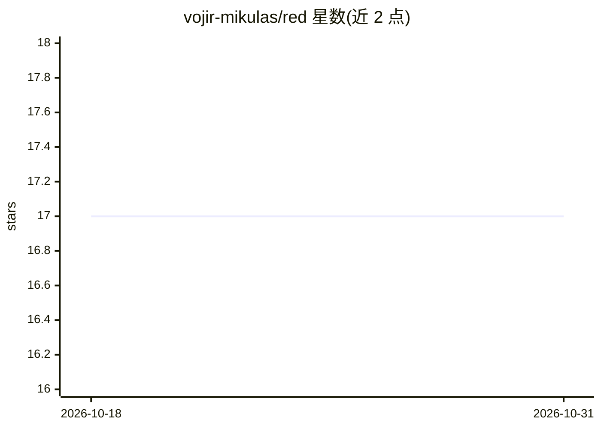

# vojir-mikulas/red

⭐ 17 · Rust · GPL-3.0 · 推送 2026-09-07 · [GitHub](https://github.com/vojir-mikulas/red) · [官网](https://red.vojir.io) · 个人维护

**Rust 桌面数据库浏览器，附带基于 Claude 的 AI 助手**

RED 是用 Rust 编写、基于 GPUI 的原生数据库探索器，支持 PostgreSQL、MySQL/MariaDB、SQLite、ClickHouse、Redis、MongoDB 的浏览、查询与编辑。功能包括 SQL 编辑器、流式分页结果网格、批量暂存编辑、CSV/JSON/XLSX 导出导入、ER 图、连接健康报告、只读连接与危险语句分级确认。AI 部分为侧边栏助手，通过 Claude API 或 Claude 订阅对 schema 进行问答并起草查询。另提供 headless CLI 与 MCP server。自述为 MVP 阶段，UI 与 API 可能变动。

## 筛选速览

| 维度 | 判定 | 备注 |
|---|---|---|
| AI 角色 | `ai-enhanced` | 去掉 AI 部分产品仍成立 |
| 许可风险 | `viral` | GPL-3.0 |
| 部署形态 | `desktop` | 安装包/桌面程序 |
| 模型依赖 | — | README 未给出锁定关系 |
| 硬件要求 | — | 无带数字的原话,不猜 |
| 安装摩擦 | `low` | 无编译、无系统依赖或容器化 |
| 成熟度 | `idea` | |

## 能力要点

- 支持 PostgreSQL/MySQL/SQLite/ClickHouse/Redis/MongoDB 六类数据库
- AI 助手侧边栏基于 schema 问答，经 Claude API 或订阅接入（opt-in）
- headless CLI（query/exec/copy/migrate 等）与 MCP server
- 提供 macOS/Linux/Windows 预编译签名二进制

## 适用场景

- 浏览与查询多个数据库、在网格中直接编辑数据
- 通过 AI 助手按 schema 起草 SQL 并生成图表
- 在生产环境以只读连接与危险语句确认机制安全操作

## 场景标签

 · 领域:数据库工具/桌面应用

## 证据(README 行号)

> L5: **Roughly Enough Data.** A fast, native database explorer built in Rust.
> L64: * AI assistant sidebar with grounded chat over your schema, via the Claude API or a Claude subscription

## 星数曲线

2026-10-18 17 → 2026-10-31 17（+0）

---
*卡片 v1 · prompt 1.4 · 生成 2026-10-29 · 置信度 high · 依据 README sha `684b7646b0e7` · [字段定义](../../DATASET.md)*
