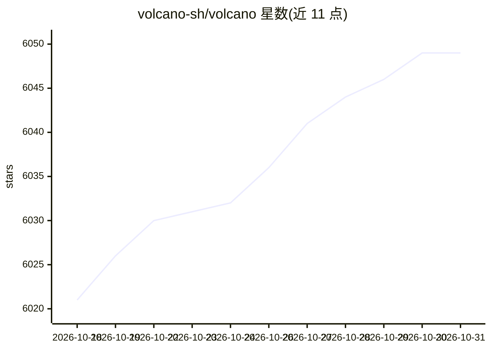

# volcano-sh/volcano

⭐ 6,049 · Go · Apache-2.0 · 推送 2026-10-28 · [GitHub](https://github.com/volcano-sh/volcano) · [官网](https://volcano.sh) · 组织维护

**Kubernetes 原生批调度系统：运行 AI/大数据/HPC 作业**

CNCF 孵化项目，扩展标准 kube-scheduler 的 Kubernetes 批调度系统，面向 AI/ML/DL 训练、生物信息/基因组学、大数据与 HPC 等批与弹性工作负载的调度管理。提供与 Spark、Flink、Ray、PyTorch、TensorFlow、MPI、Horovod、Kubeflow 等框架的集成；通过 kubectl YAML、Helm 或源码一键脚本安装，支持 x86_64 与 arm64（源码方式暂仅 x86_64），并维护与 Kubernetes 1.21–1.36 各版本的兼容矩阵。附可选的 agent、监控与 dashboard 组件。

## 筛选速览

| 维度 | 判定 | 备注 |
|---|---|---|
| AI 角色 | `ai-ecosystem` | LLM/agent 周边工具 |
| 许可风险 | `permissive` | Apache-2.0 |
| 部署形态 | `library` | 以包/库形式分发 |
| 模型依赖 | — | README 未给出锁定关系 |
| 硬件要求 | — | 无带数字的原话,不猜 |
| 安装摩擦 | `low` | 无编译、无系统依赖或容器化 |
| 成熟度 | — | 结构信号不足 |

## 能力要点

- 扩展 kube-scheduler 的批与弹性工作负载调度
- 集成 Spark/Flink/Ray/PyTorch/MPI 等大量 AI、大数据与 HPC 框架
- 提供 YAML、Helm 与源码一键安装三种方式
- 维护 Kubernetes 1.21–1.36 版本兼容矩阵

## 适用场景

- 在 Kubernetes 上调度 AI 训练与推理等批作业
- 运行 Spark/Flink 等大数据工作负载并提升资源利用
- HPC 与基因计算作业的云原生化管理

## 场景标签

`模型训练` · 领域:训练与推理

## 证据(README 行号)

> L16: Volcano is a Kubernetes-native batch scheduling system, extending and enhancing the capabilities of the standard ku
> L18: These workloads commonly leverage AI, Big Data, and HPC frameworks such as Spark, Flink, Ray, TensorFlow, PyTorch, 

## 星数曲线

2026-10-18 6,021 → 2026-10-31 6,049（+28）

---
*卡片 v1 · prompt 1.4 · 生成 2026-10-20 · 置信度 high · 依据 README sha `78399d20577c` · [字段定义](../../DATASET.md)*
