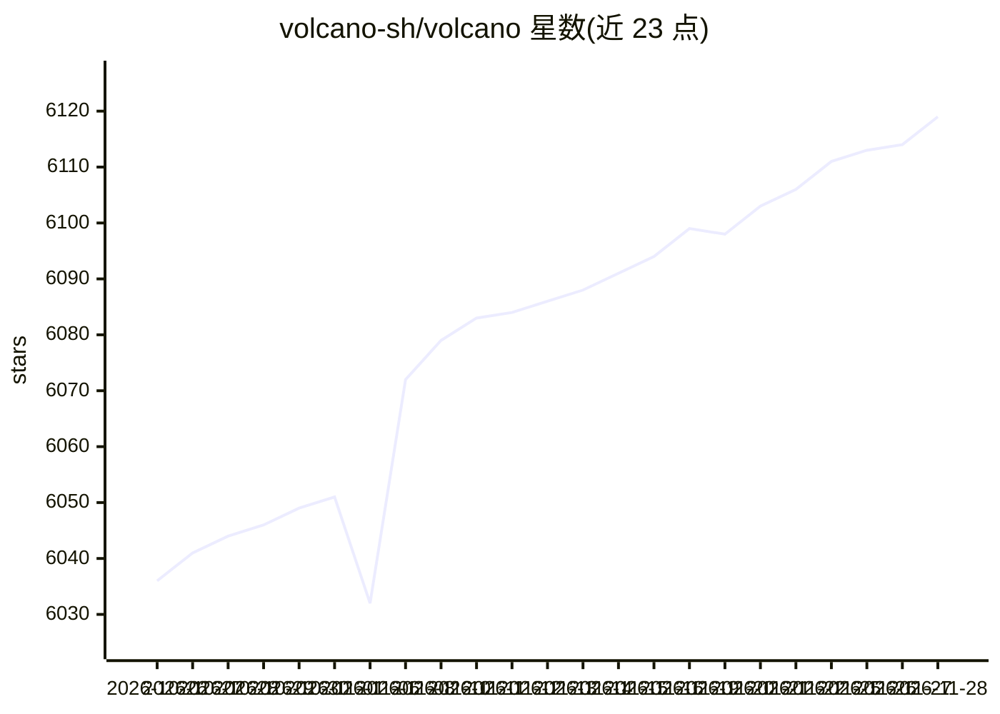

# volcano-sh/volcano

⭐ 6,119 · Go · Apache-2.0 · 推送 2026-11-26 · [GitHub](https://github.com/volcano-sh/volcano) · [官网](https://volcano.sh) · 组织维护 · 中文 README

**给 Kubernetes 集群调度 AI/大数据/HPC 批处理作业**

Volcano 是 CNCF 孵化的 Kubernetes 原生批调度系统，在标准 kube-scheduler 基础上扩展调度能力（基于 kube-batch 构建），用于管理 AI/ML/DL 训练、生物信息/基因组学及大数据等批处理与弹性负载。与 Spark、Flink、Ray、TensorFlow、PyTorch、Kubeflow、MPI、KubeGene 等框架提供集成，附带 admission、controller 组件及可选监控与仪表盘。通过 YAML、helm 或本地脚本安装在既有 Kubernetes 集群上，本地一键安装暂仅支持 x86_64。

## 筛选速览

| 维度 | 判定 | 备注 |
|---|---|---|
| AI 角色 | `ai-ecosystem` | LLM/agent 周边工具 |
| 许可风险 | `permissive` | Apache-2.0 |
| 部署形态 | `library` | 以包/库形式分发 |
| 模型依赖 | — | README 未给出锁定关系 |
| 硬件要求 | — | 无带数字的原话,不猜 |
| 安装摩擦 | `low` | 无编译、无系统依赖或容器化 |
| 成熟度 | — | 结构信号不足 |

## 能力要点

- 扩展 kube-scheduler 的 Kubernetes 原生批调度
- 集成 Spark/Flink/Ray/PyTorch/Kubeflow/MPI 等框架
- 提供 YAML、helm、本地脚本三种安装方式与可选监控组件
- 提供拓扑感知调度（HyperNode）等调度能力（据 Talks 议题）

## 适用场景

- 在 Kubernetes 上运行分布式深度学习训练作业
- 金融/制造等场景的大数据离线批处理平台
- 基因组学与 HPC 作业的容器化调度
- 在线服务与离线作业混部提升资源利用率

## 场景标签

 · 领域:云原生基础设施/作业调度

## 证据(README 行号)

> L16: Volcano is a Kubernetes-native batch scheduling system, extending and enhancing the capabilities of the standard ku
> L18: These workloads commonly leverage AI, Big Data, and HPC frameworks such as Spark, Flink, Ray, TensorFlow, PyTorch, 
> L103: - Kubernetes 1.12+ with CRD support

## 星数曲线

2026-10-26 6,036 → 2026-11-28 6,119（+83）

---
*卡片 v1 · prompt 1.4 · 生成 2026-11-22 · 置信度 high · 依据 README sha `fbfd74535208` · [字段定义](../../DATASET.md)*
