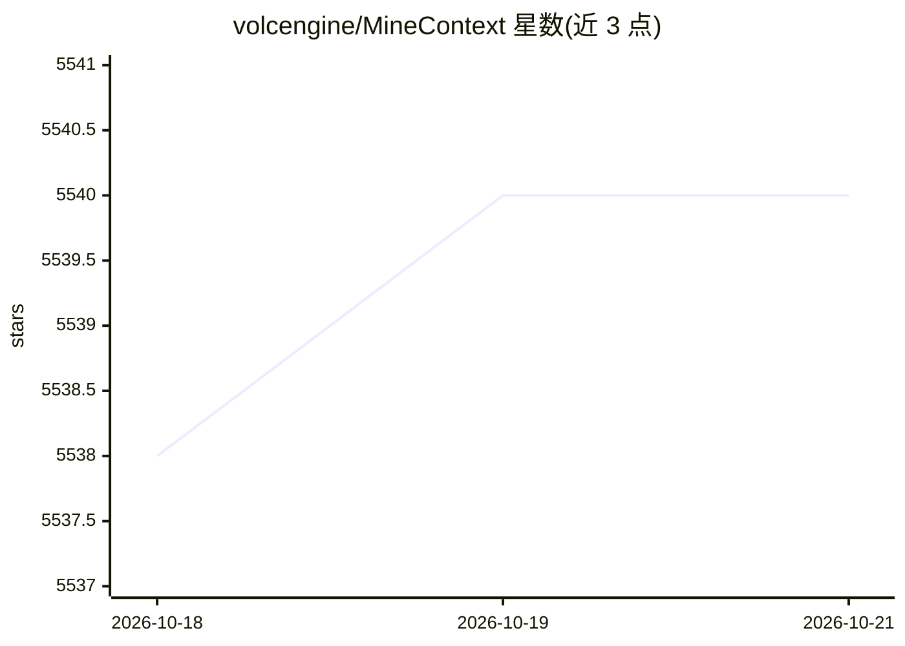

# volcengine/MineContext

⭐ 5,540 · Python · Apache-2.0 · 推送 2026-05-07 · [GitHub](https://github.com/volcengine/MineContext) · 组织维护 · 中文 README

**主动式情境感知 AI 伙伴：截屏采集上下文并主动推送洞察与摘要**

由火山引擎开源的桌面应用：通过截屏监控与内容理解持续采集用户数字世界的上下文，经文档分块、实体抽取、向量存储（SQLite/ChromaDB）与 VLM/Embedding 处理，主动推送日报/周报摘要、待办、活动记录，并支持 AI 对话问答。数据默认本地存储，支持 OpenAI 协议的自定义模型（含 LMStudio 本地模型）。前端为 Electron+React+TypeScript，后端 FastAPI，提供 macOS/Windows 安装包下载。面向知识工作者。

## 筛选速览

| 维度 | 判定 | 备注 |
|---|---|---|
| AI 角色 | `ai-native` | 本体是模型或模型工具 |
| 许可风险 | `permissive` | Apache-2.0 |
| 部署形态 | `library` | 以包/库形式分发 |
| 模型依赖 | — | README 未给出锁定关系 |
| 硬件要求 | — | 无带数字的原话,不猜 |
| 安装摩擦 | `low` | 无编译、无系统依赖或容器化 |
| 成熟度 | — | 结构信号不足 |

## 能力要点

- 截屏监控采集上下文，覆盖捕获→处理→存储→检索完整生命周期
- 主动推送日报/周报摘要、待办与活动记录
- 本地优先：数据默认存储本机，支持 OpenAI 协议本地模型
- 存储层支持 SQLite 与 ChromaDB 多后端及向量检索

## 适用场景

- 让 AI 自动记录并汇总我每天的工作内容生成周报
- 创作时自动浮现相关历史上下文辅助
- 用本地模型运行，确保截屏数据不出本机

## 场景标签

`AI 助手` `知识库管理` · 领域:对话与助手

## 证据(README 行号)

> L35: MineContext is a proactive context-aware AI partner. By utilizing screenshots and content comprehension (with futur
> L46:  Delivers key information and insights proactively in daily use. It extracts summarized content from your context—s

## 星数曲线

2026-10-18 5,538 → 2026-10-21 5,540（+2）

---
*卡片 v1 · prompt 1.4 · 生成 2026-10-20 · 置信度 mid · 依据 README sha `4fb21e879d1b` · [字段定义](../../DATASET.md)*
