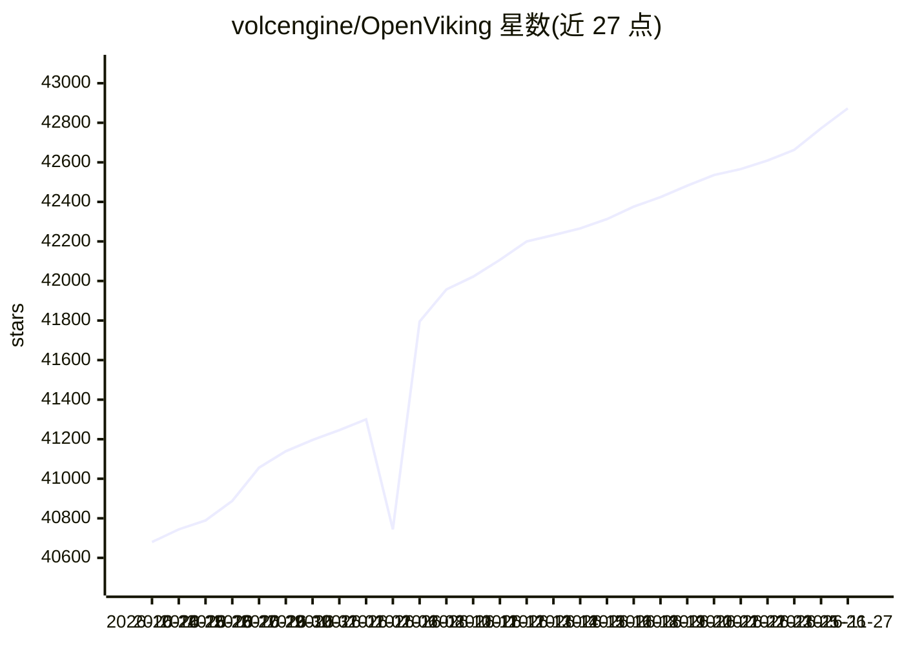

# volcengine/OpenViking

⭐ 42,873 · Python · AGPL-3.0 · 推送 2026-11-26 · [GitHub](https://github.com/volcengine/OpenViking) · [官网](https://openviking.ai) · 组织维护 · 中文 README

**为 AI Agent 提供统一知识、记忆与技能的上下文数据库**

以虚拟文件系统（viking:// URI）形式组织 Agent 上下文的开源数据库：知识、记忆与技能统一存放在目录结构中，Agent 通过 ls/read/write/grep 等文件操作浏览，目录携带 L0/L1 生成的摘要以支持先读摘要再读全文的分层加载，语义检索可限定在子树范围。会话提交后可将对话归档并抽取为可编辑的 Markdown 记忆。面向构建与使用 AI Agent 的开发者，提供 Python/Go/TypeScript SDK、HTTP API、CLI、桌面应用及 Docker 部署；自托管版采用 AGPLv3，另有托管 SaaS 与商业版。

## 筛选速览

| 维度 | 判定 | 备注 |
|---|---|---|
| AI 角色 | `ai-ecosystem` | LLM/agent 周边工具 |
| 许可风险 | `viral` | AGPL-3.0 |
| 部署形态 | `library` | 以包/库形式分发 |
| 模型依赖 | local-ok | 支持本地模型 |
| 硬件要求 | — | 无带数字的原话,不猜 |
| 安装摩擦 | `low` | 无编译、无系统依赖或容器化 |
| 成熟度 | — | 结构信号不足 |

## 动量与使用信号

- 维护:`active` — 距上次 push 0.9 天,年发版 95,297 位贡献者
- 涨星:近 1 天 **+99**(自 20261016 起算)
- 平台:— · 协议:MCP / OLLAMA

## 能力要点

- 以 viking:// 虚拟文件系统统一知识、记忆与技能，可检查和编辑
- L0 摘要/L1 概览/L2 全文三层加载与目录范围语义检索
- 提供 Claude Code、Codex、Cursor 等记忆插件安装器及 MCP/插件集成
- 在 LoCoMo 与 tau2-bench 上发布基准结果并附复现脚本

## 适用场景

- 给编码 Agent 加跨会话记忆，在新会话中回顾用户偏好
- 将项目文档、网页导入后供 Agent 按目录范围检索
- 自托管运行一个带账号隔离与 ACL 的上下文数据库

## 场景标签

`Agent 记忆` `向量数据库` `语义搜索` · 领域:Agent 开发

## 证据(README 行号)

> L31: OpenViking is an open-source context database for AI agents — one filesystem for everything an agent knows: knowled
> L133: Build your own integration with the Python, Go, or TypeScript SDK, or the HTTP API.
> L137: Connect your coding agent to OpenViking for cross-session memory. The memory plugin installer covers Claude Code, 

## 星数曲线

2026-10-24 40,680 → 2026-11-27 42,873（+2,193）

---
*卡片 v1 · prompt 1.4 · 生成 2026-11-26 · 置信度 high · 依据 README sha `1bf4a534122c` · [字段定义](../../DATASET.md)*
