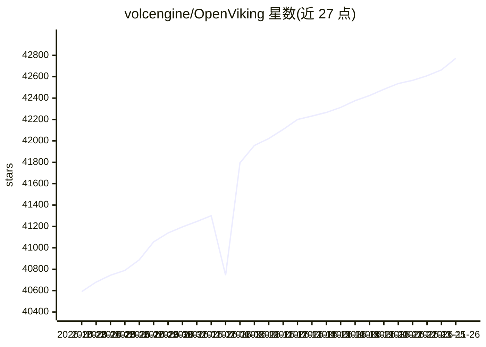

# volcengine/OpenViking

⭐ 42,772 · Python · AGPL-3.0 · 推送 2026-11-25 · [GitHub](https://github.com/volcengine/OpenViking) · [官网](https://openviking.ai) · 组织维护 · 中文 README

**AI Agent 的上下文数据库：统一记忆、知识 RAG 与技能**

以虚拟文件系统 `viking://` 形式组织 Agent 的知识、记忆与技能，Agent 通过 ls/read/write/grep 等文件操作导航上下文，目录携带 L0 摘要/L1 概览/L2 全文三级加载层，支持按子树范围的语义检索与会话归档提取记忆。以服务端形式运行（uv 安装、Docker 镜像、macOS/Windows 桌面应用），提供 Python/Go/TypeScript SDK 与 HTTP API，通过插件安装器接入 Claude Code、Codex、Cursor 等编码 Agent。开源自部署版采用 AGPLv3，另有托管 SaaS 与 BYOC 商业版。

## 筛选速览

| 维度 | 判定 | 备注 |
|---|---|---|
| AI 角色 | `ai-ecosystem` | LLM/agent 周边工具 |
| 许可风险 | `viral` | AGPL-3.0 |
| 部署形态 | `library` | 以包/库形式分发 |
| 模型依赖 | local-ok | 支持本地模型 |
| 硬件要求 | — | 无带数字的原话,不猜 |
| 安装摩擦 | `low` | 无编译、无系统依赖或容器化 |
| 成熟度 | — | 结构信号不足 |

## 动量与使用信号

- 维护:`active` — 距上次 push 0.9 天,年发版 95,297 位贡献者
- 涨星:近 1 天 **+99**(自 20261016 起算)
- 平台:— · 协议:MCP / OLLAMA

## 能力要点

- viking:// 虚拟文件系统组织知识/记忆/技能，可浏览可编辑
- L0 摘要/L1 概览/L2 全文三级上下文加载层
- 按目录子树作用域的语义检索（find/search）
- 记忆插件安装器覆盖 Claude Code、Codex、Cursor、TRAE 等工具

## 适用场景

- 为编码 Agent 提供跨会话的长期记忆
- 将项目文档、代码仓库导入为可检索的知识库
- 把会话归档并提取为可检查、可合并的记忆文件
- 自托管或托管方式为多 Agent 系统提供统一上下文存储

## 场景标签

`Agent 记忆` `RAG` · 领域:Agent 开发

## 证据(README 行号)

> L31: OpenViking is an open-source context database for AI agents — one filesystem for everything an agent knows: knowled
> L129: Build your own integration with the Python, Go, or TypeScript SDK, or the HTTP API.
> L133: Connect your coding agent to OpenViking for cross-session memory. The memory plugin installer covers Claude Code, 

## 星数曲线

2026-10-23 40,591 → 2026-11-26 42,772（+2,181）

---
*卡片 v1 · prompt 1.4 · 生成 2026-11-22 · 置信度 high · 依据 README sha `06fb85c10bbe` · [字段定义](../../DATASET.md)*
