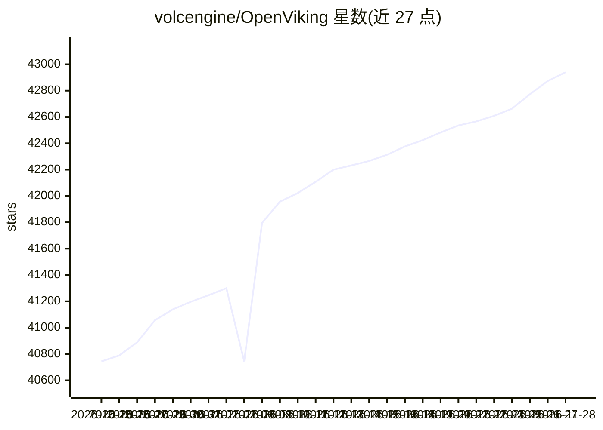

# volcengine/OpenViking

⭐ 42,940 · Python · AGPL-3.0 · 推送 2026-11-27 · [GitHub](https://github.com/volcengine/OpenViking) · [官网](https://openviking.ai) · 组织维护 · 中文 README

**为 AI Agent 提供统一的记忆/知识/技能上下文数据库**

面向 AI Agent 的开源上下文数据库，将知识、记忆与技能组织为 `viking://` 虚拟文件系统，Agent 可用 ls/tree/read/write/grep 浏览和检索，目录带 L0/L1 摘要以支持先看摘要再读全文的分层加载。会话提交后可抽取为可编辑的 Markdown 记忆。以服务端 + CLI（ov）+ Python/Go/TypeScript SDK 形式提供，支持 Docker 部署与托管版；开源版采用 AGPLv3，另有托管 SaaS 与 BYOC 商业版需许可证。评估依赖嵌入模型与 VLM。

## 筛选速览

| 维度 | 判定 | 备注 |
|---|---|---|
| AI 角色 | `ai-ecosystem` | LLM/agent 周边工具 |
| 许可风险 | `viral` | AGPL-3.0 |
| 部署形态 | `library` | 以包/库形式分发 |
| 模型依赖 | local-ok | 支持本地模型 |
| 硬件要求 | — | 无带数字的原话,不猜 |
| 安装摩擦 | `low` | 无编译、无系统依赖或容器化 |
| 成熟度 | — | 结构信号不足 |

## 动量与使用信号

- 维护:`active` — 距上次 push 0.9 天,年发版 95,297 位贡献者
- 涨星:近 1 天 **+99**(自 20261016 起算)
- 平台:— · 协议:MCP / OLLAMA

## 能力要点

- 知识/记忆/技能统一为 viking:// 虚拟文件系统，可 ls/grep 浏览
- L0 摘要/L1 概览/L2 全文三层加载，按需读取全文
- 会话提交后抽取记忆为可查看、可编辑、可合并的 Markdown
- 提供 LoCoMo、tau2-bench 评测脚本与复现指南

## 适用场景

- 给编码 Agent 加跨会话记忆，下次对话仍记得用户偏好
- 为 RAG 场景建立目录级检索范围而非全库向量扫描
- 自托管部署带用户隔离与 ACL 的 Agent 记忆服务

## 场景标签

`Agent 记忆` `RAG` · 领域:Agent 开发

## 证据(README 行号)

> L31: OpenViking is an open-source context database for AI agents — one filesystem for everything an agent knows: knowled
> L133: Build your own integration with the Python, Go, or TypeScript SDK, or the HTTP API.
> L234: VikingBot is an AI agent framework built on top of OpenViking:

## 星数曲线

2026-10-25 40,744 → 2026-11-28 42,940（+2,196）

---
*卡片 v1 · prompt 1.4 · 生成 2026-11-27 · 置信度 high · 依据 README sha `10e9d0cbee0f` · [字段定义](../../DATASET.md)*
