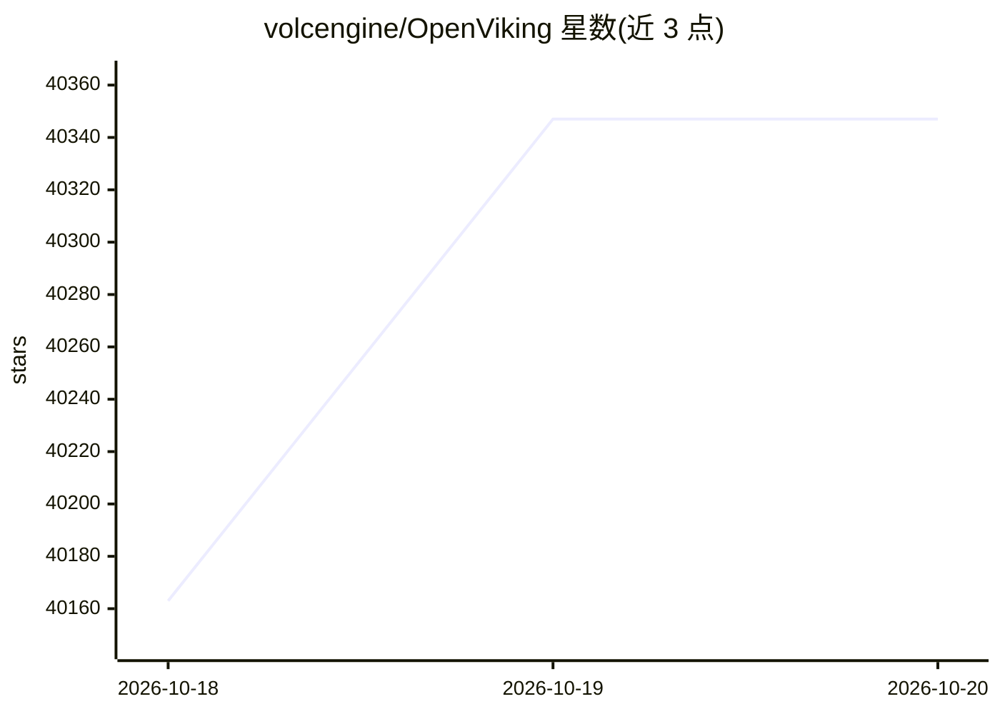

# volcengine/OpenViking

⭐ 40,347 · Python · AGPL-3.0 · 推送 2026-10-19 · [GitHub](https://github.com/volcengine/OpenViking) · [官网](https://openviking.ai) · 组织维护 · 中文 README

**给 AI Agent 的上下文数据库：统一记忆、知识与技能**

OpenViking 把 Agent 的知识、记忆与技能统一组织为 `viking://` 虚拟文件系统，Agent 可用 ls/read/grep 等文件操作浏览和编辑上下文；目录携带 L0 摘要/L1 概览/L2 全文三层结构，检索可限定在子树内。会话提交后可抽取记忆为可检查的 Markdown，VikingBot 可将素材编译为 wiki/知识图谱。服务端以 AGPLv3 开源，另提供火山引擎托管 SaaS 与 BYOC 商业版；安装依赖 uv 与 Python 3.10+，需配置一个带嵌入模型和 VLM 的模型服务。

## 筛选速览

| 维度 | 判定 | 备注 |
|---|---|---|
| AI 角色 | `ai-native` | 本体是模型或模型工具 |
| 许可风险 | `dual` | AGPL-3.0 |
| 部署形态 | `library` | 以包/库形式分发 |
| 模型依赖 | local-ok | 支持本地模型 |
| 硬件要求 | — | 无带数字的原话,不猜 |
| 安装摩擦 | `low` | 无编译、无系统依赖或容器化 |
| 成熟度 | — | 结构信号不足 |

## 动量与使用信号

- 维护:`active` — 距上次 push 0.9 天,年发版 95,297 位贡献者
- 涨星:近 1 天 **+99**(自 20261016 起算)
- 平台:— · 协议:MCP / OLLAMA

## 能力要点

- 知识与记忆、技能统一为可浏览的虚拟文件系统（viking:// URI）
- L0 摘要/L1 概览/L2 全文三层上下文加载
- 支持 Claude Code、Codex、Cursor 等记忆插件一键安装，提供 Python/Go/TypeScript SDK 与 HTTP API
- 附带 LoCoMo 与 tau2-bench 基准评测脚本（./benchmark）

## 适用场景

- 给编码 Agent 加跨会话记忆
- 把项目文档/代码导入后做目录级语义检索
- 自建带用户隔离与 ACL 的记忆服务

## 场景标签

`Agent 记忆` `语义搜索` `知识库管理` · 领域:Agent 开发

## 证据(README 行号)

> L31: OpenViking is an open-source context database for AI agents — one filesystem for everything an agent knows: knowled
> L45: - **One filesystem for knowledge, memory, and skills.** Resources hold documents and code; memories retain user pre

## 星数曲线

2026-10-18 40,163 → 2026-10-20 40,347（+184）

---
*卡片 v1 · prompt 1.4 · 生成 2026-10-18 · 置信度 high · 依据 README sha `0199df7d7e1d` · [字段定义](../../DATASET.md)*
