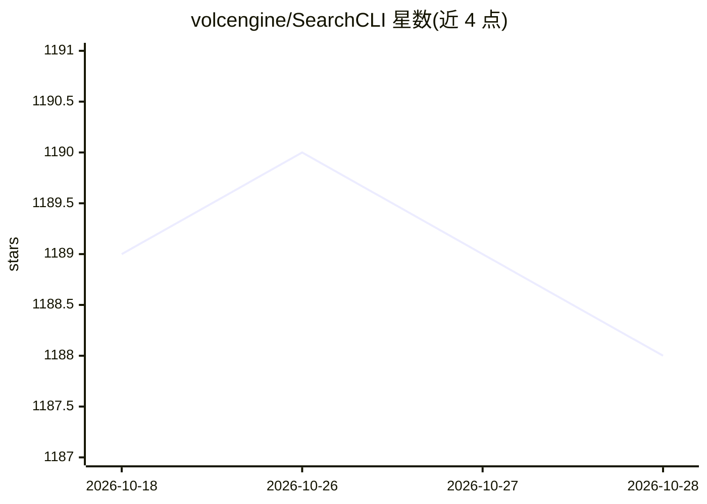

# volcengine/SearchCLI

⭐ 1,188 · TypeScript · Apache-2.0 · 推送 2026-10-16 · [GitHub](https://github.com/volcengine/SearchCLI) · 组织维护 · 中文 README

**接入火山引擎 AI Search 的命令行工具：搜索/推荐/对话式检索集成**

面向开发者和 agent 系统的开放 CLI，用于将火山引擎 AI Search 的搜索、推荐与对话式检索能力接入业务系统：通过 vs dataset/app/data 命令管理数据集与应用，vs search/recommend/chat run 做运行时验证，vs search tune 提供文本相似度评估与调优，并支持安装 Viking skills 供外部 agent 调用同一套流程。执行模型含 dry-run、确认门与写后读验证。要求 Node.js 20+、git 及火山引擎 AK/SK；调优与 LLM 相关性判定需另行配置 OpenAI 兼容 LLM API。以源码脚本方式安装。

## 筛选速览

| 维度 | 判定 | 备注 |
|---|---|---|
| AI 角色 | `ai-ecosystem` | LLM/agent 周边工具 |
| 许可风险 | `permissive` | Apache-2.0 |
| 部署形态 | `library` | 以包/库形式分发 |
| 模型依赖 | — | README 未给出锁定关系 |
| 硬件要求 | — | 无带数字的原话,不猜 |
| 安装摩擦 | `low` | 无编译、无系统依赖或容器化 |
| 成熟度 | — | 结构信号不足 |

## 能力要点

- vs dataset/app/data 应用与数据集管理，支持 JSONL 导入与 schema 推断
- vs search tune 提供自动化文本相似度评估与调优流程
- 可安装 Viking skills 供外部 agent 使用相同工作流
- dry-run、确认门与写后读验证的可审查执行模型

## 适用场景

- 为 agent 系统或业务系统接入火山引擎 AI Search 的搜索与推荐能力
- 在上线前以可审查流程完成数据导入与应用配置验证
- 外部 agent 通过安装 Viking skills 操作搜索、推荐与对话检索

## 场景标签

`RAG` `语义搜索` `推荐系统` · 领域:知识与检索

## 证据(README 行号)

> L13: If your agent system or business system needs stable, tunable information distribution services, SearchCLI gives yo
> L15: With SearchCLI and its installable `Viking skills`, external agents can onboard data, build and validate search and
> L21: - The command-line integration surface for AI Search on Volcengine.

## 星数曲线

2026-10-18 1,189 → 2026-10-28 1,188（-1）

---
*卡片 v1 · prompt 1.4 · 生成 2026-10-21 · 置信度 mid · 依据 README sha `ac18e71b6776` · [字段定义](../../DATASET.md)*
