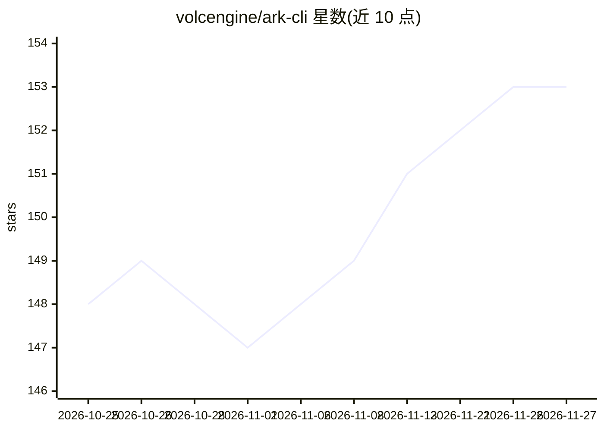

# volcengine/ark-cli

⭐ 153 · jq · Apache-2.0 · 推送 2026-11-11 · [GitHub](https://github.com/volcengine/ark-cli) · [官网](https://console.volcengine.com/ark/region:cn-beijing/arkcli) · 组织维护 · 中文 README

**把火山方舟能力接入终端与本地 AI Agent 的 CLI 工具**

火山引擎出品的命令行工具，将方舟平台的模型调用、图片/视频生成、多模态理解（OCR/语音转写/字幕打轴）、Plan 管理、精调、Endpoint 部署、用量账单与诊断能力封装为 arkcli 命令；并通过 +connect 安装 Ark Skills、配置 Harness/MCP，使 Claude Code、OpenCode、Codex 等本地 Agent 能以自然语言调用这些能力。经 npm 全局安装，支持无浏览器环境的认证登录，单命令即可从提示词得到生成结果或已部署服务。

## 筛选速览

| 维度 | 判定 | 备注 |
|---|---|---|
| AI 角色 | `ai-ecosystem` | LLM/agent 周边工具 |
| 许可风险 | `permissive` | Apache-2.0 |
| 部署形态 | `library` | 以包/库形式分发 |
| 模型依赖 | — | README 未给出锁定关系 |
| 硬件要求 | — | 无带数字的原话,不猜 |
| 安装摩擦 | `low` | 无编译、无系统依赖或容器化 |
| 成熟度 | — | 结构信号不足 |

## 能力要点

- 一条命令完成模型调用、图片/视频生成或多模态理解，产物自动下载到本地
- +connect 将 Ark Skills 注入本地 Agent，支持清理卸载恢复环境
- 覆盖精调、Endpoint 一键部署、Usage/Billing/Doctor 治理闭环
- 支持 SSO 登录自动配置身份与 API Key，提供 --no-browser 无浏览器认证

## 适用场景

- 让 Claude Code 等本地 Agent 通过自然语言调用火山方舟模型与生成能力
- 在远程开发机、CI 或 Agent 沙箱等无浏览器环境中完成方舟认证
- 一条命令把基础或精调模型部署为 Endpoint 并管理用量与账单

## 场景标签

`图像生成` `视频生成` `多模态` · 领域:内容生成

## 证据(README 行号)

> L9: 火山方舟模型、生成、多模态理解、Plan、精调、部署、用量、账单和诊断能力，都可以通过 Ark CLI + Skills 交给 Claude Code、OpenCode、Codex 等本地 Agent 调用。
> L30: Ark CLI 不是让你记住更多命令，而是把火山方舟 MaaS 平台能力变成 Agent 可以调用的工具箱。

## 星数曲线

2026-10-25 148 → 2026-11-27 153（+5）

---
*卡片 v1 · prompt 1.4 · 生成 2026-11-27 · 置信度 high · 依据 README sha `49e009958ff0` · [字段定义](../../DATASET.md)*
