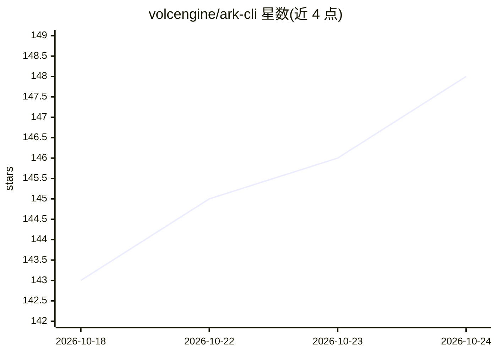

# volcengine/ark-cli

⭐ 148 · jq · Apache-2.0 · 推送 2026-10-22 · [GitHub](https://github.com/volcengine/ark-cli) · [官网](https://console.volcengine.com/ark/region:cn-beijing/arkcli) · 组织维护 · 中文 README

**把火山方舟能力接入终端与 AI Agent 的官方 CLI**

火山引擎官方发布的 npm CLI 工具，将火山方舟 MaaS 平台能力封装为命令行与 Agent Skills：支持文本/多模态对话、Seedream 生图、Seedance 生视频、OCR、语音转写、文档抽取，以及 Plan 套餐管理、模型精调、一键部署 Endpoint、用量账单查询与 doctor 诊断。通过 arkcli +connect 将内置 Skills 安装到 Claude Code、Codex 等本地 Agent，使其以自然语言调用方舟能力。认证默认走火山 SSO，计费操作带确认步骤，Apache-2.0 许可。

## 筛选速览

| 维度 | 判定 | 备注 |
|---|---|---|
| AI 角色 | `ai-ecosystem` | LLM/agent 周边工具 |
| 许可风险 | `permissive` | Apache-2.0 |
| 部署形态 | `library` | 以包/库形式分发 |
| 模型依赖 | — | README 未给出锁定关系 |
| 硬件要求 | — | 无带数字的原话,不猜 |
| 安装摩擦 | `low` | 无编译、无系统依赖或容器化 |
| 成熟度 | — | 结构信号不足 |

## 能力要点

- arkcli +connect 将内置 Skills 注入本地 Agent（Claude Code / Codex 等）
- 覆盖对话、多模态理解、图片/视频生成、精调、部署、用量账单与诊断的命令集
- 火山 SSO 登录后自动完成身份与 API Key 配置，支持 --no-browser 无浏览器授权

## 适用场景

- 让本地 AI Agent 调用火山方舟的模型与媒体生成能力
- 通过命令行完成模型选型、开通套餐到部署 Endpoint 的流程
- 查询用量与账单、用 doctor 排障

## 场景标签

 · 领域:LLM 基础设施/云服务 CLI

## 证据(README 行号)

> L9: 火山方舟模型、生成、多模态理解、Plan、精调、部署、用量、账单和诊断能力，都可以通过 Ark CLI + Skills 交给 Claude Code、OpenCode、Codex 等本地 Agent 调用。
> L30: Ark CLI 不是让你记住更多命令，而是把火山方舟 MaaS 平台能力变成 Agent 可以调用的工具箱。

## 星数曲线

2026-10-18 143 → 2026-10-24 148（+5）

---
*卡片 v1 · prompt 1.4 · 生成 2026-10-22 · 置信度 high · 依据 README sha `6e60e21ad74e` · [字段定义](../../DATASET.md)*
