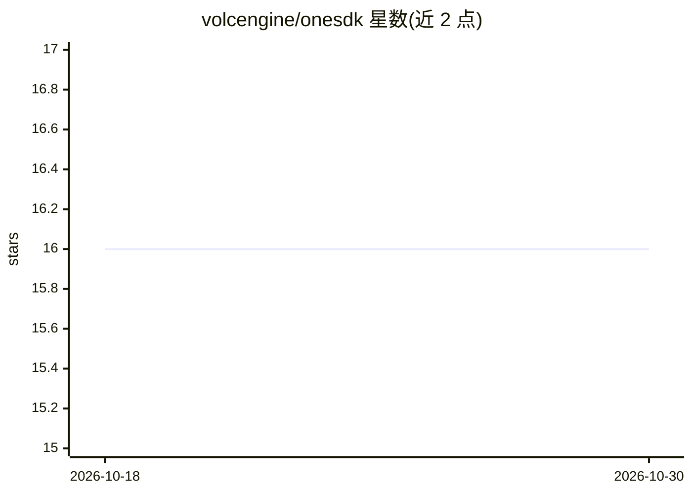

# volcengine/onesdk

⭐ 16 · C · Apache-2.0 · 推送 2026-08-04 · [GitHub](https://github.com/volcengine/onesdk) · 组织维护 · 中文 README

**面向边缘设备的统一 AI 接入与 IoT 管理 C/C++ SDK**

字节跳动火山引擎开源的客户端/边缘侧 AI 集成开发包：基于 libwebsockets 实现 HTTP/WebSocket/MQTT 协议，提供大模型文本聊天（流式/非流式）、图像识别与文生图、对接 Realtime WebSocket API 的语音 Agent 等能力；同时支持 OTA 升级、Token 配额查询、SSH、日志上传等设备管理与设备身份认证。可运行于 ESP32、FreeRTOS、uc-OS2 及 Linux/macOS/Windows。需 CMake 构建编译（3.10+，不兼容 4.x），不兼容 4.x 版本 CMake。

## 筛选速览

| 维度 | 判定 | 备注 |
|---|---|---|
| AI 角色 | `ai-ecosystem` | LLM/agent 周边工具 |
| 许可风险 | `permissive` | Apache-2.0 |
| 部署形态 | `None` |  |
| 模型依赖 | — | README 未给出锁定关系 |
| 硬件要求 | — | 无带数字的原话,不猜 |
| 安装摩擦 | `medium` | 含编译或系统依赖之一 |
| 成熟度 | — | 结构信号不足 |

## 能力要点

- 文本聊天/图像生成/Realtime 语音 Agent 等 LLM 能力封装
- MQTT 设备管理：OTA 整包与差分升级、配额查询、SSH、日志上传
- 设备侧一机一密/一型一密认证与设备证书
- 跨平台：ESP32/FreeRTOS/uc-OS2/Linux/macOS/Windows

## 适用场景

- 在 ESP32 等嵌入式设备上接入大模型对话与语音能力
- 为边缘设备同时集成 AI 推理与云端 IoT 管理
- 构建需要 OTA 升级与设备认证的智能硬件固件

## 场景标签

 · 领域:嵌入式/边缘 AI 与 IoT

## 证据(README 行号)

> L9: OneSDK is an integrated development kit for AI applications on the client-side. It provides large language model (LL

## 星数曲线

2026-10-18 16 → 2026-10-30 16（+0）

---
*卡片 v1 · prompt 1.4 · 生成 2026-10-30 · 置信度 high · 依据 README sha `2431103d70d4` · [字段定义](../../DATASET.md)*
