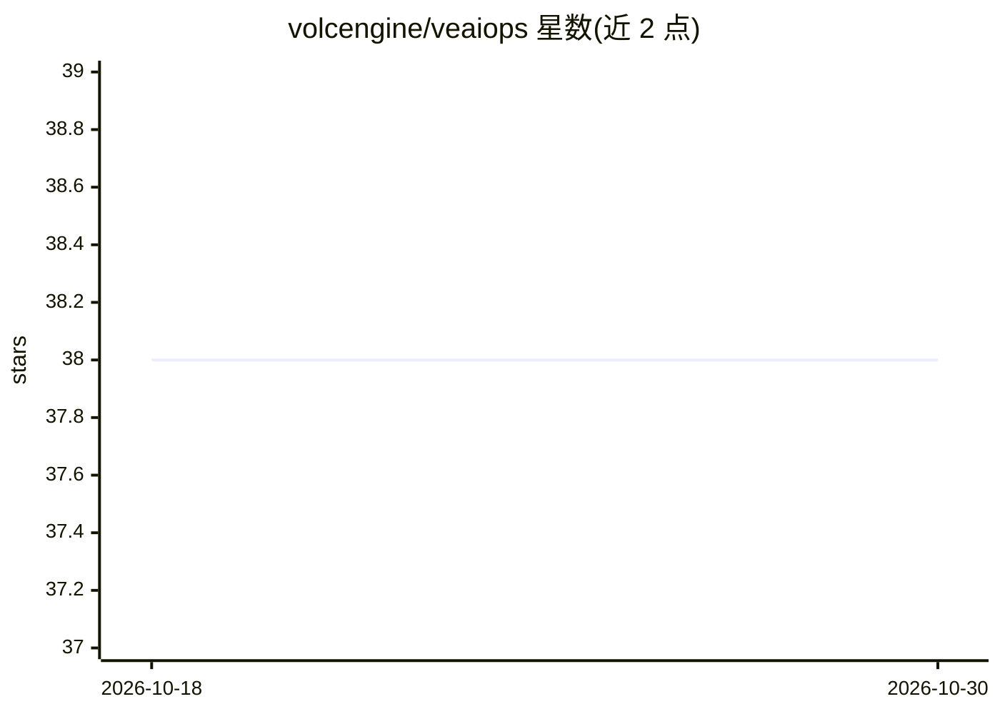

# volcengine/veaiops

⭐ 38 · TypeScript · Apache-2.0 · 推送 2026-06-03 · [GitHub](https://github.com/volcengine/veaiops) · [官网](https://volcengine.github.io/veaiops/) · 组织维护 · 中文 README

**火山引擎开源 AIOps 套件：ChatOps 值班助手+智能告警阈值+可观测性**

由火山引擎开源的 AIOps 套件，包含三部分：群聊中的 ChatOps Agent（过滤、响应、留存信息并自我升级）、基于 ML 检测器与任意指标数据源的智能阈值（自动推荐并持续校准告警阈值）、统一管理多租户机器人的项目/角色/密钥/消息卡片模板控制台。支持本地开发（Python 3.12+/Node.js 18+/MongoDB 5+/pnpm 8+/uv）与 Kubernetes Helm 两种部署；后端 FastAPI，前端 Modern.js+React，数据源支持火山引擎、阿里云、Zabbix（工厂模式可插拔）。

## 筛选速览

| 维度 | 判定 | 备注 |
|---|---|---|
| AI 角色 | `ai-native` | 本体是模型或模型工具 |
| 许可风险 | `permissive` | Apache-2.0 |
| 部署形态 | `library` | 以包/库形式分发 |
| 模型依赖 | — | README 未给出锁定关系 |
| 硬件要求 | — | 无带数字的原话,不猜 |
| 安装摩擦 | `medium` | 含编译或系统依赖之一 |
| 成熟度 | — | 结构信号不足 |

## 能力要点

- 群聊 24/7 值班 ChatOps Agent，支持信息过滤/响应/留存/自升级
- ML 检测器接入任意指标源，自动推荐并持续校准告警阈值
- 统一控制台管理多租户机器人的项目、角色、密钥与消息卡片模板
- 提供本地开发与 Kubernetes Helm Chart 两种部署方式

## 适用场景

- 在值班群聊中接入 AI 助手处理告警与协作
- 自动为指标数据源推荐和校准告警阈值
- 统一管理多租户 ChatOps 机器人的配置与生命周期

## 场景标签

`AI 助手` `聊天机器人` · 领域:对话与助手

## 证据(README 行号)

> L3: An open-source AIOps suite from Volcengine that unifies ChatOps Agent, intelligent alerting, and observability, feat
> L7: - ChatOps: Adds a 24/7 on-call copilot to group chat—one that filters, responds, retains and self-upgrades informati
> L9: - Intelligent Threshold: Integrates ML-powered detectors with any metric data source to automatically recommend and 

## 星数曲线

2026-10-18 38 → 2026-10-30 38（+0）

---
*卡片 v1 · prompt 1.4 · 生成 2026-10-25 · 置信度 high · 依据 README sha `61b128bbb373` · [字段定义](../../DATASET.md)*
