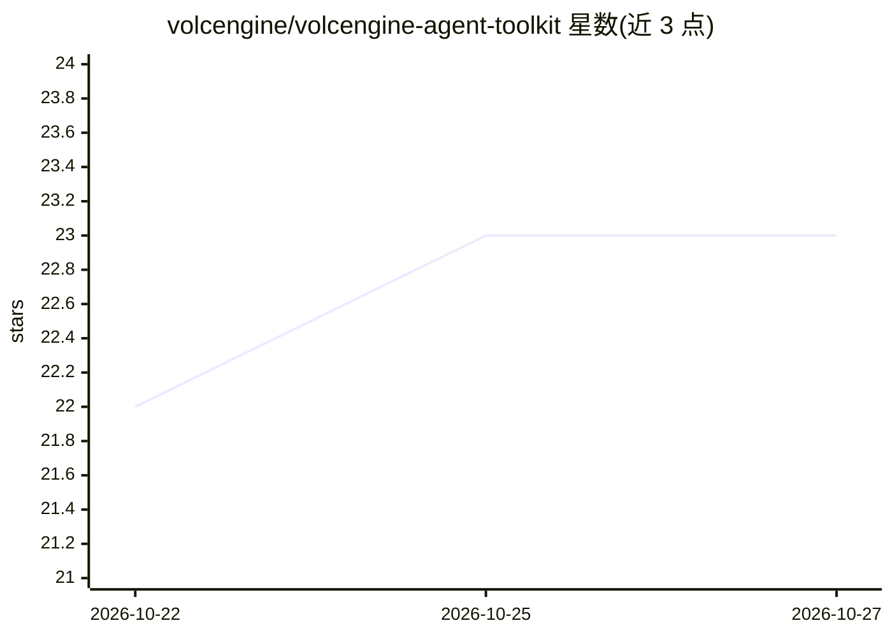

# volcengine/volcengine-agent-toolkit

⭐ 23 · Python · MIT · 推送 2026-10-26 · [GitHub](https://github.com/volcengine/volcengine-agent-toolkit) · 组织维护 · 中文 README

**火山引擎 skill 市场：让 AI coding agent 管理云资源**

火山引擎团队维护的 skill/plugin 市场，面向 Claude Code、Codex、Cursor、Gemini CLI、OpenCode 等 AI coding agent。默认仅安装核心插件（CLI 管理、排障、文档检索、技能发现、反馈等 6 个 skill），其余按产品域（存储、数据库、安全、身份、服务支持等）拆分为可选 skill，由 volcengine-find-skills 统一发现并按需安装。Agent 通过 ve CLI（要求 ve >= 1.1.9）转发产品命令并注入调用方标识。MIT 许可。

## 筛选速览

| 维度 | 判定 | 备注 |
|---|---|---|
| AI 角色 | `ai-ecosystem` | LLM/agent 周边工具 |
| 许可风险 | `permissive` | MIT |
| 部署形态 | `library` | 以包/库形式分发 |
| 模型依赖 | — | README 未给出锁定关系 |
| 硬件要求 | — | 无带数字的原话,不猜 |
| 安装摩擦 | `low` | 无编译、无系统依赖或容器化 |
| 成熟度 | — | 结构信号不足 |

## 能力要点

- 按产品域拆分的 22 个 skill，默认只装核心插件
- volcengine-find-skills 统一发现 catalog 并按需精确安装单个 skill
- 通过 ve CLI 转发 tosutil/arkcli 等产品命令，注入 Agent 调用方标识
- 支持 Codex/Claude Code/Gemini CLI/OpenCode/Cursor 五种宿主安装路径

## 适用场景

- 在 AI coding agent 对话中直接管理火山引擎云资源
- 让 Agent 检索火山引擎官方文档全文
- 分析云费用归因、诊断资源错误与配额问题
- 用 Terraform 或部署 skill 将代码仓库部署到火山引擎

## 场景标签

`编码 Agent` · 领域:编码与开发

## 证据(README 行号)

> L9: 火山引擎团队维护的 skill marketplace，面向 Claude Code / Codex / OpenCode / Cursor / Gemini CLI
> L10: 等 AI coding agent。仓库默认只安装核心插件；其他技能按火山引擎产品域拆分为可选插件，由
> L76: 4. finder 对所有宿主都通过 skills CLI 直接安装选中的 skill，不安装整个 plugin。

## 星数曲线

2026-10-22 22 → 2026-10-27 23（+1）

---
*卡片 v1 · prompt 1.4 · 生成 2026-10-27 · 置信度 high · 依据 README sha `6e5db2334965` · [字段定义](../../DATASET.md)*
