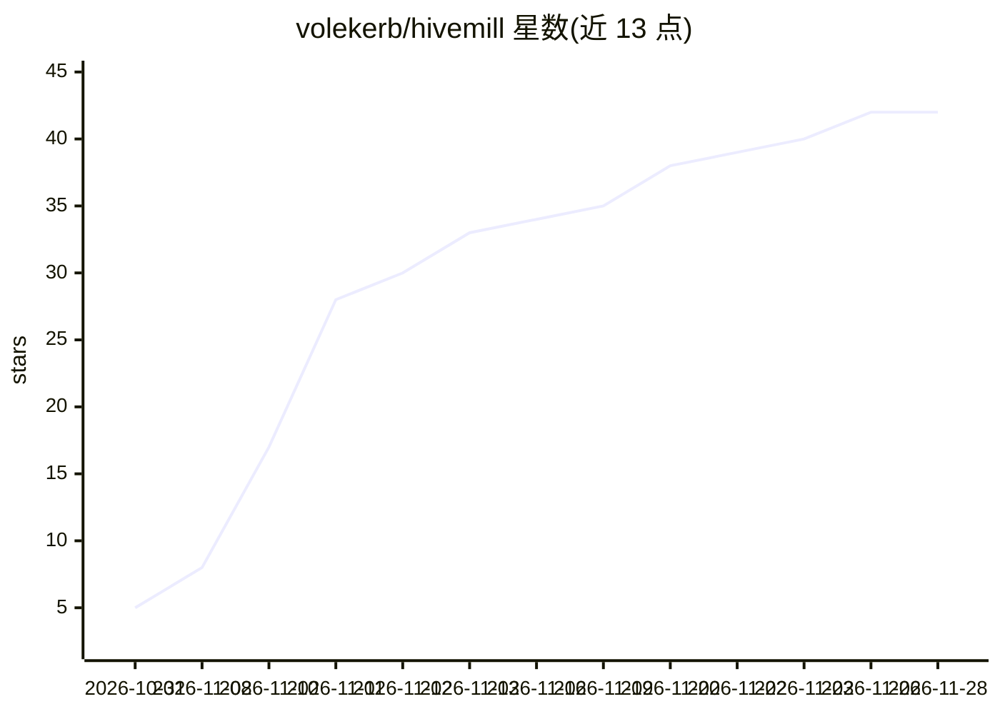

# volekerb/hivemill

⭐ 42 · Go · MIT · 推送 2026-11-27 · [GitHub](https://github.com/volekerb/hivemill) · [官网](https://hivemill.dev) · 个人维护

**自托管 Claude Code/Cursor 多智能体软件工厂，带评审与合并门禁**

面向开发者的自托管 AI 编码智能体编排系统：用户向 boss agent 描述目标，director 组建团队，coder、reviewer、QA 与 judge 组成固定角色链，coder 只开 PR 不合并，judge 仅在 reviewer 与 QA 均通过真实测试运行后合并。支持 Claude Code 与 Cursor 两种运行时共享同一台机器与 SQLite 数据库；含 worker guard 钩子、可选沙箱、spawn 资源门控、只读 Web UI 与 Herdr 桌面面板。限单机、Web UI 无鉴权、隔离为绊线而非安全边界。以 Claude Code 插件方式安装，需 Debian/Ubuntu 与已登录的 Claude Code。

## 筛选速览

| 维度 | 判定 | 备注 |
|---|---|---|
| AI 角色 | `ai-ecosystem` | LLM/agent 周边工具 |
| 许可风险 | `permissive` | MIT |
| 部署形态 | `None` |  |
| 模型依赖 | — | README 未给出锁定关系 |
| 硬件要求 | — | 无带数字的原话,不猜 |
| 安装摩擦 | `low` | 无编译、无系统依赖或容器化 |
| 成熟度 | — | 结构信号不足 |

## 能力要点

- coder/reviewer/QA/judge 角色分离，judge 仅在评审与 QA 通过后合并
- Claude 与 Cursor 双运行时共享一台机器与同一 SQLite 数据库
- worker guard 钩子与可选沙箱、按角色 GitHub token 等遏制机制
- spawn 门控按 RAM/负载/进程数排队，适配小规格单机

## 适用场景

- 让一组 AI 智能体以固定角色流水线完成需求并自动评审合并
- 在单台机器上同时运行 Claude Code 与 Cursor 智能体组织
- 通过只读 Web UI 或 Herdr 面板观察目标、智能体、吞吐与成本

## 场景标签

`多智能体` `编码 Agent` `代码审查` · 领域:Agent 开发

## 证据(README 行号)

> L3:  Hivemill is a self-hosted software factory of AI coding agents (Claude Code and Cursor), with separate review, QA a
> L38: You describe what you want built to one boss agent. A director staffs a team, and a chain of coders, QA, reviewers 
> L96: - **Two orgs, one box.** An org is a complete chain of command (boss, director, leads, workers) on one runtime and 

## 星数曲线

2026-10-31 5 → 2026-11-28 42（+37）

---
*卡片 v1 · prompt 1.4 · 生成 2026-11-18 · 置信度 high · 依据 README sha `4aa3b69e7bb8` · [字段定义](../../DATASET.md)*
