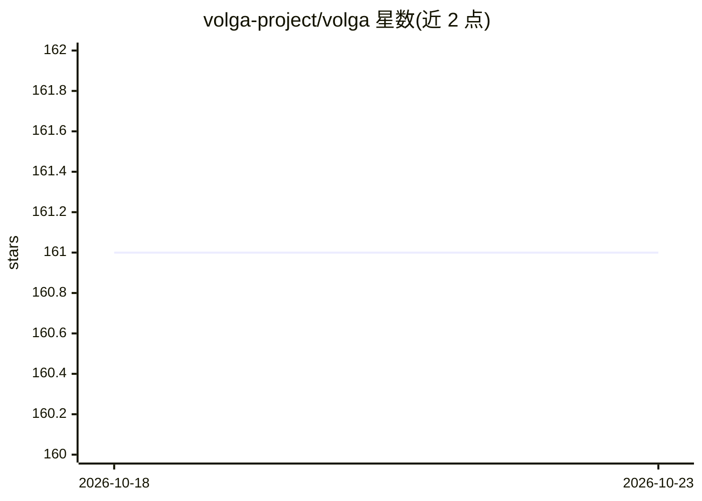

# volga-project/volga

⭐ 161 · Rust · Apache-2.0 · 推送 2026-09-27 · [GitHub](https://github.com/volga-project/volga) · [官网](https://volgaai.substack.com) · 组织维护

**统一实时数据引擎：一份 SQL 支持流式、批处理与请求服务三种模式**

Rust 编写的 split-path 数据流引擎，基于 Apache Arrow 与 DataFusion，同一 SQL 可运行于 streaming、batch 与 request（serving）三种模式：request 模式将数据流图切分为写路径（流式 worker 维护共享状态中的中间结果）与读路径（request worker 按需计算最终结果）。提供 exactly-once 事件时间处理、无状态 worker 与可插拔状态后端（内存、Scylla、SlateDB+对象存储）、Kubernetes operator。面向需要流处理+在线服务+回填一体的数据/特征工程团队。当前处于活跃开发中，Scylla/SlateDB 后端、批处理与 joins 在路线图上。

## 筛选速览

| 维度 | 判定 | 备注 |
|---|---|---|
| AI 角色 | `ai-ecosystem` | LLM/agent 周边工具 |
| 许可风险 | `permissive` | Apache-2.0 |
| 部署形态 | `self-host` | docker 或自建部署 |
| 模型依赖 | — | README 未给出锁定关系 |
| 硬件要求 | — | 无带数字的原话,不猜 |
| 安装摩擦 | `low` | 无编译、无系统依赖或容器化 |
| 成熟度 | `idea` | |

## 能力要点

- 一份 SQL 三种执行模式（streaming/request/batch）共享算子逻辑
- split-path request 模式：写路径维护中间状态、读路径按请求计算，无需外部 KV
- 无状态 worker + 可插拔状态后端（内存/Scylla/SlateDB）
- Kubernetes 原生：kubevolga Go operator 与 VolgaPipeline CRD

## 适用场景

- 流式与在线服务共用同一 SQL 定义，避免多系统拼接
- 反欺诈/支付/推荐等按 key 长窗口场景的在线-离线一致计算
- 通过 Kubernetes operator 部署与运行数据流管道

## 场景标签

 · 领域:数据基础设施/流处理

## 证据(README 行号)

> L12: **Volga** is a ***split-path dataflow engine***: one SQL can run in **streaming**, **batch** (regular dataflow), or
> L24: That stitch is most painful on entity-centric workloads — fraud, payments, ads, recsys, search, RAG — long per-key 
> L31: - **Stateless workers.** Compute–storage separation: workers do not own operator state. Operators talk to store con

## 星数曲线

2026-10-18 161 → 2026-10-23 161（+0）

---
*卡片 v1 · prompt 1.4 · 生成 2026-10-22 · 置信度 mid · 依据 README sha `1541b526885d` · [字段定义](../../DATASET.md)*
