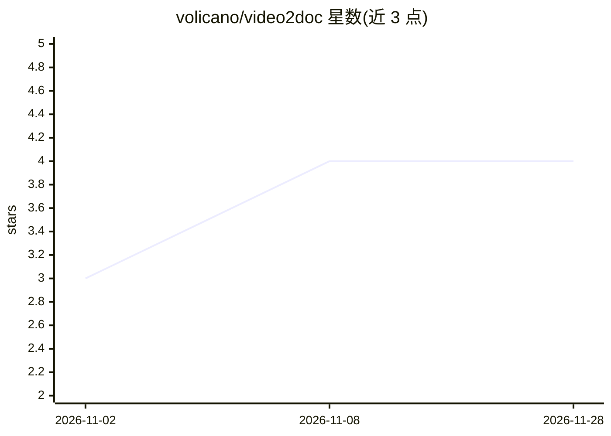

# volicano/video2doc

⭐ 4 · Python · MIT · 推送 2026-11-04 · [GitHub](https://github.com/volicano/video2doc) · [官网](https://pypi.org/project/video2doc/) · 个人维护 · 中文 README

**把面试/教学视频转成带配图单页图文教程的 CLI 工具**

面向个人学习者的视频转图文流水线 CLI：输入 B 站/YouTube/抖音链接或本地视频，依次执行下载、抽音轨、字幕复用或语音识别（默认 faster-whisper）、术语校正、信息密度抽帧、OCR、图文对齐、LLM 分段与逐节写作、质检，输出自包含单页 HTML 与 Markdown。每阶段产物落盘并按指纹缓存，支持断点续跑与浏览器本地校对界面。需要 Python 3.11+ 与 ffmpeg；LLM 密钥缺失时自动跳过写作阶段。

## 筛选速览

| 维度 | 判定 | 备注 |
|---|---|---|
| AI 角色 | `ai-native` | 本体是模型或模型工具 |
| 许可风险 | `permissive` | MIT |
| 部署形态 | `library` | 以包/库形式分发 |
| 模型依赖 | local-ok | 支持本地模型 |
| 硬件要求 | — | 无带数字的原话,不猜 |
| 安装摩擦 | `medium` | 含编译或系统依赖之一 |
| 成熟度 | — | 结构信号不足 |

## 能力要点

- 可缓存、断点续跑的多阶段流水线，按指纹判定是否重跑
- 本地语音识别（faster-whisper）与 OCR（rapidocr-onnxruntime）完全离线可用
- LLM 只负责分段打标/写作/质检，时间戳由代码按句子编号换算
- 支持 v2doc review 本地校对界面与 overrides.json 手工覆盖重渲染

## 适用场景

- 把 B 站/YouTube 教学视频整理成可发布的图文学习笔记
- 把面试复盘视频转成带时间戳、可跳回原片的教程
- 离线环境下用本地模型跑完转写与配图流水线

## 场景标签

`语音识别` `OCR` `AI 写作` · 领域:内容生成

## 证据(README 行号)

> L5: 输入一条 B 站 / YouTube / 抖音链接（抖音支持直接粘贴分享文本）或本地视频，输出一份可以直接发布的学习笔记：结构化的章节、可跳回原片的时间戳、关键画面截图。
> L22: video2doc 把这件事拆成一条**可缓存、可断点续跑的流水线**，LLM 只在三个地方出手：分段打标、写作、质检。其余全是确定性代码：
> L163: M3 会把转写发给 LLM（默认 DeepSeek）。分段只让模型回答「从第几句开始、标题是什么」，**时间戳一律由代码按句子编号换算**；写作时把这一节的口播、配图及 OCR 文字一起交给它，并要求只使用材料里的信息。

## 星数曲线

2026-11-02 3 → 2026-11-28 4（+1）

---
*卡片 v1 · prompt 1.4 · 生成 2026-11-21 · 置信度 high · 依据 README sha `c7d59a2d4fc0` · [字段定义](../../DATASET.md)*
