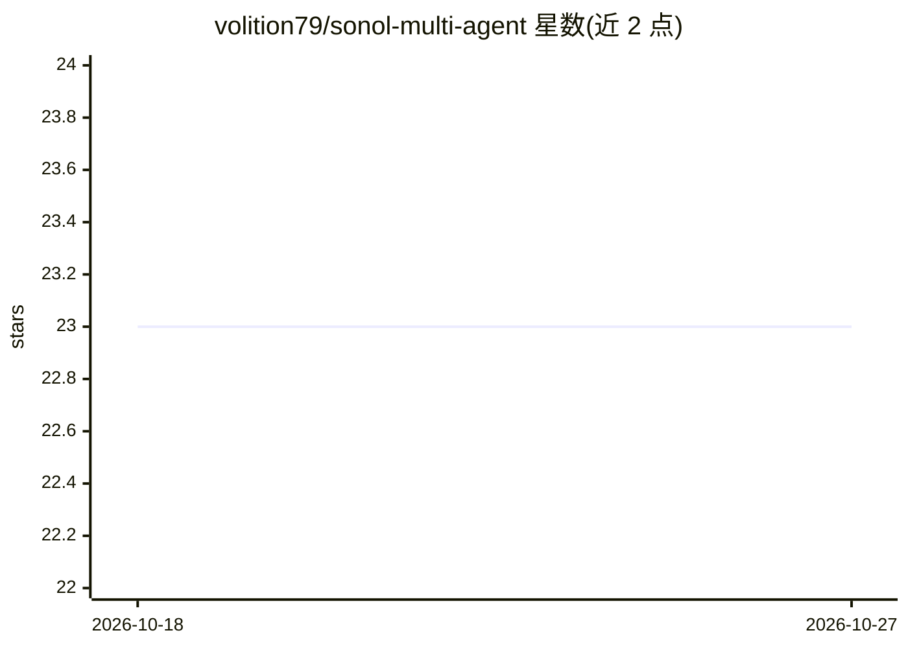

# volition79/sonol-multi-agent

⭐ 23 · JavaScript · NOASSERTION · 推送 2026-04-19 · [GitHub](https://github.com/volition79/sonol-multi-agent) · [官网](https://youtu.be/ke5bSL2LWb0?si=xYdgDFbRzpdLmoFx) · 组织维护

**面向 Codex CLI 与 Claude Code 的本地多 agent 编排技能包**

由 Source Playground 发布的两个 Sonol 技能（sonol-multi-agent 与 sonol-agent-runtime），须成对安装到 Codex CLI 或 Claude Code 的 skills 目录，用于多 agent 编排流程，包含 UI 仪表盘查看子 agent 流向，编排状态以本地 SQLite 为权威数据源，本地桥接负责仪表盘与运行时访问。仅在 WSL 上的 Codex CLI 与 Windows 上的 Claude Code 环境经过测试，其他环境未验证。

## 筛选速览

| 维度 | 判定 | 备注 |
|---|---|---|
| AI 角色 | `ai-ecosystem` | LLM/agent 周边工具 |
| 许可风险 | `none` | NOASSERTION |
| 部署形态 | `None` |  |
| 模型依赖 | — | README 未给出锁定关系 |
| 硬件要求 | — | 无带数字的原话,不猜 |
| 安装摩擦 | `low` | 无编译、无系统依赖或容器化 |
| 成熟度 | — | 结构信号不足 |

## 能力要点

- 两个技能（编排与运行时）成对安装，覆盖 Codex CLI 与 Claude Code
- UI 仪表盘审查子 agent 流向
- 本地 SQLite 为编排状态的权威存储
- 本地优先：浏览器存储不作为编排状态来源

## 适用场景

- 在 Codex CLI/Claude Code 中运行多 agent 编排流程
- 通过仪表盘回看子 agent 的执行流向
- 在本地保留编排状态便于追溯

## 场景标签

`多智能体` · 领域:Agent 开发

## 证据(README 行号)

> L3: This repository contains the public release of two Sonol skills:
> L8: Both skills must be installed together. Installing only one of them can break the orchestration flow, runtime report
> L80: - This repository publishes the external public-release payload for the local Sonol client/runtime surface.
> L81: - Local SQLite state remains authoritative for orchestration state.

## 星数曲线

2026-10-18 23 → 2026-10-27 23（+0）

---
*卡片 v1 · prompt 1.4 · 生成 2026-10-27 · 置信度 mid · 依据 README sha `0876dd767617` · [字段定义](../../DATASET.md)*
