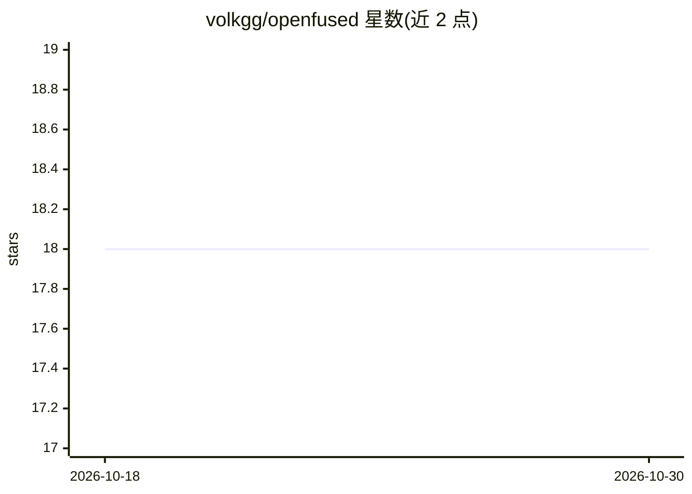

# volkgg/openfused

⭐ 18 · Rust · MIT · 推送 2026-06-20 · [GitHub](https://github.com/volkgg/openfused) · [官网](https://openfused.dev) · 组织维护

**基于纯文件的 AI agent 持久上下文与加密消息层**

通过目录约定为任意 AI agent 提供持久化、可共享的上下文存储：CONTEXT.md 工作记忆、PROFILE.md 公开身份卡、加密 inbox 收件箱，以 Ed25519 签名与 age 加密保障消息可信。支持多 agent 共享工作区、订阅广播、信任分级标签、SSH/HTTP 两种同步传输、公共密钥注册表与托管邮箱。提供 MCP 服务器（13 个工具）与 A2A 协议门面，任何模型/云上的 agent 均可读写，以 npm 包与 Docker 方式分发。

## 筛选速览

| 维度 | 判定 | 备注 |
|---|---|---|
| AI 角色 | `ai-ecosystem` | LLM/agent 周边工具 |
| 许可风险 | `permissive` | MIT |
| 部署形态 | `self-host` | docker 或自建部署 |
| 模型依赖 | — | README 未给出锁定关系 |
| 硬件要求 | — | 无带数字的原话,不猜 |
| 安装摩擦 | `low` | 无编译、无系统依赖或容器化 |
| 成熟度 | — | 结构信号不足 |

## 能力要点

- 目录约定式持久上下文（CONTEXT.md/PROFILE.md/inbox），无运行时锁定
- Ed25519 签名 + age 加密（X25519/ChaCha20-Poly1305）的 agent 间消息与信任分级
- MCP 服务器（13 工具）与 Google/Linux Foundation A2A 协议门面
- 公共注册表（密钥托管、撤销、轮换、防抢注）与免费托管邮箱

## 适用场景

- 让 AI agent 在会话结束后保留并共享工作记忆
- 多 agent 团队在共享工作区中协同与收发加密消息
- 通过 MCP 客户端（Claude Code/Cursor 等）将 OpenFused 作为工具服务器接入
- 无服务器的 agent 使用托管邮箱收发签名消息

## 场景标签

`多智能体` `Agent 记忆` · 领域:Agent 开发

## 证据(README 行号)

> L7: AI agents lose their memory when conversations end. Context is trapped in chat windows, proprietary memory systems, 
> L9: No vendor lock-in. No proprietary protocol. Just a directory convention that any agent on any model on any cloud can
> L184: Any MCP client (Claude Desktop, Claude Code, Cursor) can use OpenFused as a tool server:

## 星数曲线

2026-10-18 18 → 2026-10-30 18（+0）

---
*卡片 v1 · prompt 1.4 · 生成 2026-10-29 · 置信度 high · 依据 README sha `6fbd55e44fc5` · [字段定义](../../DATASET.md)*
